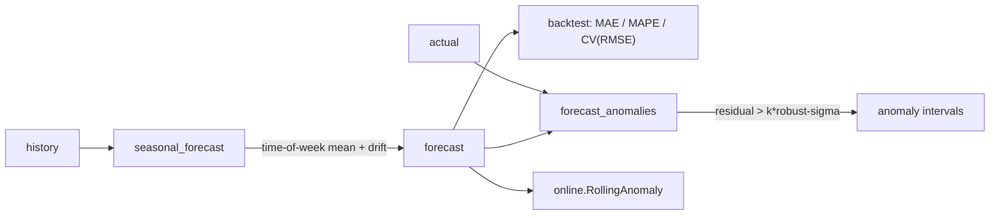

# Load forecasting & learned-normal anomalies

`camber.forecast` adds a dependency-light forecaster **on top of** — not replacing — the
deterministic core, plus anomaly detection off its residual. No ML dependency (numpy/pandas only);
honest about being a transparent baseline, not a black-box model.

*Time-of-week shape plus drift produces a forecast; deviations beyond a robust residual band become learned-normal anomalies.*



## Forecast — `seasonal_forecast`

```python
from camber.forecast import seasonal_forecast

fc = seasonal_forecast(history, horizon_index)  # both DatetimeIndexed
```

**Seasonal-naïve shape + additive drift.** Each target interval is predicted from the mean of
history at the same **time-of-week** slot (the daily/weekly occupancy shape a change-point model
misses), plus an additive **drift** correction (the recent mean residual of actual vs its own slot
mean) so slow drift is followed *without* distorting the shape. Slots unseen in history fall back
to the overall mean.

Flags: `drift_window` (samples used for the drift term; default 168 = a week of hours),
`max_horizon` (default 14 days; see below).

**Intended horizon: next day to next week.** The drift term is the recent level held flat, so the
forecast cannot follow a season turning, and months ahead its bias grows large. When the latest
target lies more than `max_horizon` past the end of history, a `ForecastHorizonWarning` (a
`UserWarning`) is issued. The forecast is still returned. Pass a larger `max_horizon`, or `None`,
to accept a longer horizon knowingly. For months-ahead or weather-driven projection use the
temperature models in `camber.mandv`. The same warning, with the count, says when target intervals
fall in time-of-week slots history never saw and take the overall mean. Give at least a full
week of history to avoid it.

## Backtest — `backtest`

```python
from camber.forecast import backtest

backtest(history, test_frac=0.25)  # {n_test, mae, mape, cv_rmse}
```

Holds out the last `test_frac`, forecasts it, and reports MAE / MAPE / CV(RMSE) — a quick honesty
check on the forecaster for a given series before you rely on it.
The hold-out is forecast in one piece, so its length is the horizon. A hold-out longer than
`max_horizon` (passed through to `seasonal_forecast`) draws the `ForecastHorizonWarning`, and the
accuracy reported is then that of a longer horizon than the forecaster is built for. Keep
`test_frac × history` within two weeks to score the intended use.

## Learned-normal anomalies — `forecast_anomalies`

```python
from camber.forecast import forecast_anomalies

rep = forecast_anomalies(actual, forecast, k=3.5)
rep.n_anomalies, rep.anomaly_frac, rep.band, rep.timestamps
```

Flags intervals whose actual deviates from the forecast beyond `±k·σ`, where σ is the residual's
robust (median/MAD) scale — so a few big deviations don't inflate the threshold. This turns "unlike
its own recent normal" into an FDD signal, complementing the physics-based rules (a building can be
within every rule's bounds yet behaving unlike itself). Flag: `k` (band width in robust σ).

## Relation to M&V

The change-point / TOWT models in `camber.mandv` are **temperature-driven** and built for savings
baselines with uncertainty. This forecaster is **time-of-week driven** and built for short-horizon
operations + anomaly baselines. Use M&V for savings; use this for next-day/next-week load and
learned-normal deviation. For a streaming residual monitor, pair with
`camber.mandv.online.RollingAnomaly`.
