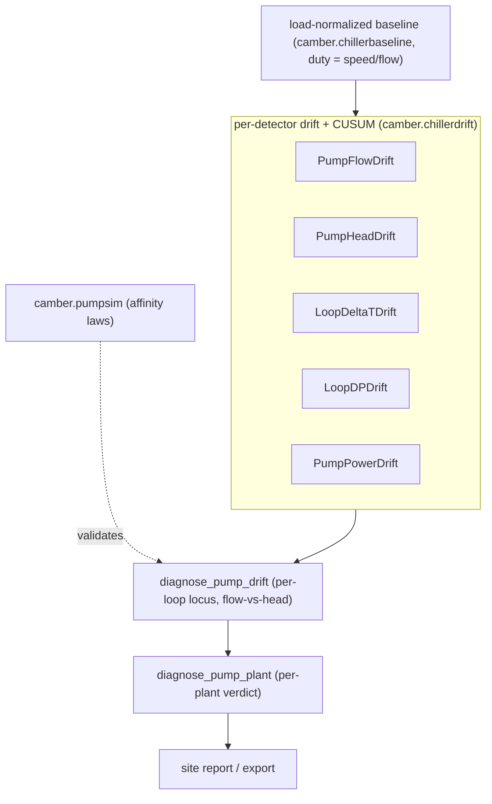
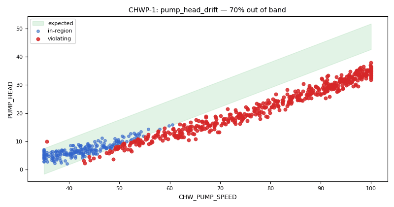

# Pump / hydronic drift detection

The chiller drift family ([CHILLER-DRIFT.md](CHILLER-DRIFT.md)) asks "is this machine slowly getting
worse than it used to be, at matched load?" The pump / hydronic family asks the same question of the
**distribution side** — pumps and the loops they serve — reusing the exact same load-normalized
frozen-baseline engine (`camber.chillerbaseline`, `camber.chillerdrift`), only with a *duty*
normalizer (pump speed or flow) in place of thermal tons.



*Duty-normalized baselines feed five per-detector drifts; co-movement rolls up per-loop, then per-plant, with pumpsim as the physics check.*



*Synthetic data: `pumpsim` with impeller wear, drawn by `drift_evidence` for `pump_head_drift`. At high speed the pump no longer makes the head it did.*

Like the chiller detectors, each is a **period rule** (`Registry.run_periods`), freezes a
load-normalized baseline into a `BaselineStore` on first use, reports a period statistic **and** a
sustained-shift CUSUM alarm, labels its thresholds *screening-grade* / *provisional-untuned*
(`camber.driftthresholds`), and **declines loudly** (never reads healthy) when an instrumented point
is missing. They are loop-parameterized — one class serves a chilled-water or hot-water loop; the
equip identifies which pump.

## The detector family

| Detector | Signal | Normalizer | Sided | Catches |
|---|---|---|---|---|
| `PumpFlowDrift` | flow | pump speed (Q ∝ N) | down | pump wear (impeller/wear-ring), clogged strainer, cavitation, entrained air — a flow **deficit** at matched speed |
| `PumpHeadDrift` | differential head | pump speed (H ∝ N²) | down | pump wear directly — a head **deficit** at matched speed; with flow, disambiguates pump-wear from system-resistance |
| `LoopDeltaTDrift` | loop ΔT (return − supply) | flow (or speed proxy) | both | low-ΔT syndrome (collapse: overpumping, fouled coils, stuck valves, bypass) vs underflow/starvation (widen) |
| `LoopDPDrift` | loop differential pressure | flow (system curve DP ∝ Q²) | both | rising system resistance / valve-authority loss vs bypass / stuck-open — with the DP-reset schedule subtracted out |
| `PumpPowerDrift` | electrical power | flow (P ∝ Q³) | up | wire-to-water efficiency loss (bearing/seal drag, degrading motor/drive, recirculation) — a power **excess** at matched flow |

**Loop DP is unit-free.** Sites trend DP in psi, inH₂O, kPa or ftH₂O. `LoopDPDrift`'s plausibility
band is scaled to the baseline's own median DP (`dp_plausible_range`: −0.25…5× the median, which
still rejects sentinel codes) instead of the former fixed 0–100 that assumed psi — a boiler loop
with a 480.5 inH₂O setpoint was rejected sample-by-sample and the rule declined, blaming "too few
loaded samples". Pass `dp_range=` to fix the band explicitly. Every pump/loop drift rule now names
the real reason when it declines (`camber.chillerbaseline.unscoreable_reason`): a metric that is all
missing, a load gate no sample meets (with the observed median), a band no reading falls in (check
units), too few samples, or too narrow a load range.

**An `ok` loop ΔT names no fault.** Since 0.105 (#153) an `ok` `loop_deltat_drift` Finding says the
ΔT "holds near its baseline" and gives the signed shift and its σ. Only `warn` and `fault` name a
direction and a cause ("collapsed … low-ΔT syndrome", "widened … starvation").

**Flow-at-matched-speed is the pump-wear signal.** A healthy VFD pump delivers a repeatable flow at a
given speed; a deficit means the pump (or its suction) has degraded. It is **one-sided down** — only a
deficit is a fault — so `ApproachDriftMonitor` gained a `direction="down"` mode for it (alongside the
existing `up` and `both`).

**The confound is stated, not hidden.** A flow deficit at matched speed is ambiguous between *pump
wear* and a *rise in system resistance* (a throttled or stuck-closed valve downstream). Load
normalization doesn't remove it, so when a loop differential-pressure point is mapped the rule reports
the concurrent DP shift and **caveats** a deficit that co-moves with *rising* DP — the resistance
signature, not pump wear. (The head-drift detector and the loop diagnosis, coming next in the family,
resolve it further: flow↓ **and** head↓ → the pump; flow↓ with head steady → the distribution.)

## One per-loop verdict

The four detectors fail *independently* (a worn impeller, a throttled valve, a fouled coil, and a
lost DP setpoint are different faults) but corroborate when a problem is loop-wide.
`camber.pumpdrift.diagnose_pump_drift(findings)` reads them and returns one localized
`PumpDriftDiagnosis` — naming each cause, flagging **corroboration** when two or more agree, and
running the **flow-vs-head disambiguation** that no single signal can do:

- flow deficit **and** head deficit at matched speed → **the pump itself** (impeller / wear-ring /
  cavitation), corroborated;
- flow deficit with head **steady** → **the distribution** (a throttled / stuck-closed valve
  downstream), not pump wear — look at the loop, not the impeller;
- flow deficit with **no head point** → called ambiguous rather than asserted.

It splits the loop into a mechanical (pump) and a hydraulic (distribution) side and reports a `locus`
(steady · pump · distribution · loop-wide) with a `loop_wide` flag — the pump-side analog of
`condenserdrift`'s tower-disambiguates-head-pressure check. Screening-grade; pure over Findings.

## One per-plant verdict

Real plants run several pumps. `camber.pumpplantdiag.diagnose_pump_plant(diagnoses)` rolls the
per-loop `PumpDriftDiagnosis` objects into one plant verdict with the cross-pump reasoning: exactly
one pump drifting → **single-pump** (stage the spare, schedule that impeller); two or more loops on
the **distribution** side → a shared/central hydraulic cause (plant-wide low-ΔT, a decoupler bypass, a
control problem) is more likely than several independent pumps; two or more pumps otherwise →
**plant-wide** (a common-mode cause — suction, water chemistry, a shared drive). It reports a plant
`locus` (steady · single-pump · distribution · plant-wide) and a plain-language `recommendation`.

## Surfacing the verdict

The per-loop and per-plant verdicts flow downstream like the chiller ones:
`camber.integrate.export.pump_diagnoses_to_frame` / `export_pump_diagnoses` write one row per loop
(locus · severity · loop_wide · corroborated · causes · fingerprint) to CSV/JSON/Parquet, and
`camber.report.pump_diagnosis_table` renders a worst-first HTML table. `build_site_report(...,
pump_diagnoses=[...])` splices that table into the owner-facing site report, alongside the chiller
verdict table.

## Running the family

From a config, no Python needed — add a `drift` section naming this family (`"family": "pump"`) and run
`camber drift freeze` once to establish the references, then `camber drift run` to score. `camber
run` folds the verdicts into the ordinary audit report. Only `freeze` (and the attributed
`accept_new_normal`) ever writes a baseline; scoring is read-only. See
**[CLI.md](CLI.md#drift-baselines)**.

```sh
camber drift freeze config.json      # establish the references (refuses to overwrite)
camber drift run    config.json      # score current vs baseline, worst-first
camber drift accept config.json --equip <EQ> --by <NAME> --reason "<what changed>"
```

## Hot-water loops

The `pump` family reads the chilled-water roles. Since 0.105 (#152) the `hw_pump` family runs the
same five detectors on a hot-water loop (`camber.rules.hw_pump_rules`):

| Detector | Rule name | Signal | Normalizer |
|---|---|---|---|
| `HwPumpFlowDrift` | `hw_pump_flow_drift` | `hw_flow` | `hw_pump_speed` (or `pump_status`); `hw_diff_press` / `hw_diff_press_sp` for the resistance caveat |
| `HwPumpHeadDrift` | `hw_pump_head_drift` | `pump_head` | `hw_pump_speed` (or `pump_status`); `hw_flow` confound |
| `HwLoopDeltaTDrift` | `hw_loop_deltat_drift` | supply − return (`hw_supply_temp` − `hw_return_temp`) | `hw_flow` |
| `HwLoopDPDrift` | `hw_loop_dp_drift` | `hw_diff_press` | `hw_flow`; `hw_diff_press_sp` |
| `HwPumpPowerDrift` | `hw_pump_power_drift` | `power` | `hw_flow` |

A hot-water loop's warm side is its supply, so the ΔT is supply − return. A collapse is still
low-ΔT syndrome and a widening is still starvation. The physics, the size-relative gates, the
thresholds and the metric keys are the chilled-water detector's own. `diagnose_pump_drift` and
the plant roll-up read either loop, and `"plant"` works on an `hw_pump` entry too:

```json
{"drift": {"families": [{"class": "HW_PLANT", "family": "hw_pump", "plant": "HW plant"}]}}
```

**Two loops on one equipment.** Each hot-water detector has its own rule name and its own
baseline-store kind (`hw_pump_flow`, `hw_pump_head`, `hw_loop_deltat`, `hw_loop_dp`,
`hw_pump_power`). An equipment that carries both loops, with `pump` and `hw_pump` entries on the
same class, keeps one frozen baseline per loop. `pump_status`, `pump_head` and `power` have no
loop of their own, so on such an equipment both families read the same point. Map each pump as
its own equipment when each has its own status, head and power.

A hot-water loop with no flow meter can still be scored on ΔT from Python:
`HwLoopDeltaTDrift(store, load_role=Role.HW_PUMP_SPEED)` uses the pump speed as the affinity
proxy, gated at the learned VFD floor.

**On `lbnl-boiler`.** Run with the fault-free run as the declared reference, over all 17 runs.
The dataset maps the lead pump's speed and status, boiler 1's flow, the loop supply and return
temperatures and the loop DP and its setpoint. It has no pump head point, and the pump power
point is not mapped.
- **Pump speed gate:** the lead pump's learned VFD floor is 28.9 %, so its speed gate is 30.9 %.
- **`hw_loop_deltat_drift`:** the PI-mistuning run is a `warn`, a ΔT collapse of 1.6 °F
  (3.0σ). The eight temperature-bias runs are `fault`s of 3.6 °F (±2 °F bias) and 7.2 °F
  (±4 °F bias), collapsing for a positive bias and widening for a negative one. The boiler
  supply bias moves the loop supply it controls, and the loop sensor bias moves the measured ΔT.
  The detector cannot tell a biased temperature sensor from a real change in ΔT. The three
  fouling runs and the four DP-sensor-bias runs are `ok`.
- **`hw_pump_flow_drift` and `hw_loop_dp_drift`:** `ok` on every run. The largest flow shift is
  a −22 gpm deficit (−1.9σ) at the −20 DP-sensor bias.
- **`hw_pump_head_drift`:** declines (no head point).

None of these runs is a pump fault, and boiler fouling stays the job of `boiler_efficiency_drift`.
The `lbnl-boiler` run template does not include `hw_pump`, so its workbook answers are unchanged.

## Pump size and constant-speed pumps

Until 0.104 the detectors gated on fixed numbers: 50 gpm of flow, a 15 % speed, a 15 / 30 gpm flow
deficit and a 1 / 2 kW power excess. A 40 gpm pump never reaches 50 gpm, so the loop ΔT, loop DP and
pump-power detectors declined on it, and a worn impeller's whole deficit sat under the 15 gpm floor.
Since 0.104 (#150) each gate is derived from the baseline period, capped at the old value, and an
explicit constructor value always wins (`camber.rules._pumpgates`):

| Gate | Default | Cap (pumps at or above it gated as before) |
|---|---|---|
| minimum flow / identifiable flow span | 10 % / 20 % of the baseline's p95 flow (`size_relative_load_gates`, as the chiller rules since 0.84) | 50 / 10 gpm (500 gpm) |
| minimum speed | the learned VFD floor (`camber.chwpump.learn_vfd_floor`) + 2 points, else 15 % | none: speed is already relative |
| flow-deficit floor (`pump_flow_drift`) | 2 % / 4 % of the baseline's p95 flow | 15 / 30 gpm (750 gpm) |
| power-excess floor (`pump_power_drift`) | 5.5 % / 11 % of the baseline's p95 power | 1 / 2 kW (18.2 kW) |
| flow-rise confound (`pump_head_drift`) | 2.5 % of the baseline's p95 flow | 20 gpm (800 gpm) |

The speed gate leaves out the samples a pump spends parked at its drive minimum: there the drive,
not the load, sets the speed, so they say nothing about flow or head *at* a speed.
`loop_deltat_drift` uses the speed gate too when a pump speed stands in for flow (it used 50).

The sigma floors still carry the weight. The gpm and kW floors are backstops against a very tight
baseline. On the original 1000 gpm pump (p95 983–993 gpm, 19.7–19.9 kW) the old floors were 1.5 %
of flow and 5.1 % of power, so any larger fraction leaves every full-size result unchanged.
Within that bound:
- **Flow:** the sigma floor binds first for every fraction from 1.6 % to 3 % at every size, so
  2 % / 4 % keeps the backstop at or above typical flow-meter accuracy.
- **Power:** the kW floor does bind on small pumps. At 6 % a small pump catches bearing drag
  0.125–0.25 severity later than the full-size pump; 5.5 % keeps it within 0.125.

Head, loop DP and ΔT are pressures and a temperature difference, so their floors do not scale.

**Constant-speed pumps** have no speed curve to normalize on. `pump_flow_drift` and
`pump_head_drift` treat a pump as constant-speed in two cases:
- its speed varies by at most 2 % (coefficient of variation over the baseline, `constant_speed_cv`);
- it has no speed point but has a running status. The two detectors now run on a speed point *or*
  a status.

Instead of declining, such a pump's flow and head are compared as a **flat level** at its fixed
speed, inside the band they were observed at. The Finding carries a caveat that a level change is
pump wear *or* a change in the system curve: a throttled or re-set balancing valve moves a
constant-speed pump back along its curve just as wear does. The flow detector's rising-DP
resistance caveat still applies.

In the same way, a loop whose flow barely moves (`constant_cv`, 2 %) gets a flat-level baseline in
`loop_deltat_drift`, `loop_dp_drift` and `pump_power_drift`, valid within 5 % of its median flow
beyond the observed band. A current period outside that band is not scored. Each Finding reports
the gates and floors it used:
- `*_speed_gate_pct` / `*_load_gate`;
- `*_gate_source`: `explicit`, `size_relative`, `learned_vfd_floor` or `default`;
- `*_vfd_floor_pct` and `*_warn_floor_*`;
- `*_speed_mode` / `*_normalizer_mode`;
- `*_baseline_model`.

**The size sweep.** `camber.pumpsim` takes `design_flow_gpm`, which scales flow, power and their
noise, plus `fixed_speed` and `speed_point=False`. The sweep runs every fault at severities 2–4
(2 seeds each) and 10 healthy plus 6 DP-reset runs per size. Each cell is the number of cases the
detector flagged (warn or fault), 0.103 → 0.104.

Variable-speed pump:

| Pump (gpm) | Flow faults (`pump_flow_drift`) | Head (`pump_head_drift`) | Bearing drag (`pump_power_drift`) | ΔT faults (`loop_deltat_drift`) | DP faults (`loop_dp_drift`) | Locus right | False alarms |
|---|---|---|---|---|---|---|---|
| 20 | 0 → 24 of 24 | 18 → 18 of 18 | 0 → 6 of 6 | 0 → 10 of 12 | 0 → 11 of 12 | 24 → 47 of 48 | 0 → 0 of 18 |
| 40 | 0 → 24 of 24 | 18 → 18 of 18 | 0 → 6 of 6 | 0 → 10 of 12 | 0 → 11 of 12 | 24 → 47 of 48 | 0 → 0 of 18 |
| 100 | 0 → 24 of 24 | 18 → 18 of 18 | 0 → 6 of 6 | 10 → 10 of 12 | 11 → 11 of 12 | 41 → 47 of 48 | 0 → 0 of 18 |
| 200 | 8 → 24 of 24 | 18 → 18 of 18 | 0 → 6 of 6 | 10 → 10 of 12 | 11 → 11 of 12 | 41 → 47 of 48 | 0 → 0 of 18 |
| 500 | 24 → 24 of 24 | 18 → 18 of 18 | 4 → 6 of 6 | 10 → 10 of 12 | 11 → 11 of 12 | 45 → 47 of 48 | 0 → 0 of 18 |
| 1000 | 24 → 24 of 24 | 18 → 18 of 18 | 6 → 6 of 6 | 10 → 10 of 12 | 11 → 11 of 12 | 47 → 47 of 48 | 0 → 0 of 18 |

Every size now detects and localizes what the 1000 gpm pump does. The 1000 gpm results are
unchanged: `tests/golden/pumpsim_fullsize.json`, captured at 0.103, pins them. The cases still
missed are the same at every size: valve-authority loss at severity 2 for loop ΔT, and one
severity-2 case for loop DP.

Constant-speed pump (the same at every size from 20 to 1000 gpm; a status-only pump with no speed
point reads the same):

| Detector | 0.103 | 0.104 |
|---|---|---|
| Flow faults (`pump_flow_drift`) | declined | 24 of 24 |
| Head (`pump_head_drift`) | declined | 18 of 18 |
| Bearing drag, ΔT, DP | declined below 500 / 200 / 200 gpm | 6 of 6, 10 of 12, 10 of 12 |
| Locus right | 6 to 29 of 48 | 45 of 48 |
| False alarms | 0 of 18 | 0 of 18 |

A constant-speed pump cannot change its flow by more than the system curve allows, so the sim's
severity-4 faults that move flow by 8 to 14 % leave the flat level's band. The loop detectors then
decline those samples rather than score them. The one place the flat level misleads is
severity-4 overpumping (+8 % flow at fixed speed). There, the extra power the extra flow draws
reads as an efficiency loss, and the loop reads loop-wide instead of distribution in 2 of 6 cases.

## Calibration

Thresholds are constructor arguments (screening-grade); the CUSUM parameters are provisional-untuned.
As with the chiller family, `camber.driftvalidation` (`LabeledCase` / `evaluate` / `sweep`) tunes them
once labelled pump-fault periods exist, and the physics generator `camber.pumpsim` (affinity laws + system
curve) characterizes the family end-to-end without a dataset — on clear faults the loop diagnosis
localizes to the right `locus` at ~100% with no false alarms on healthy loops or a DP-reset schedule,
and it proves the flow-vs-head disambiguation (impeller wear → pump, clogged strainer → distribution).
