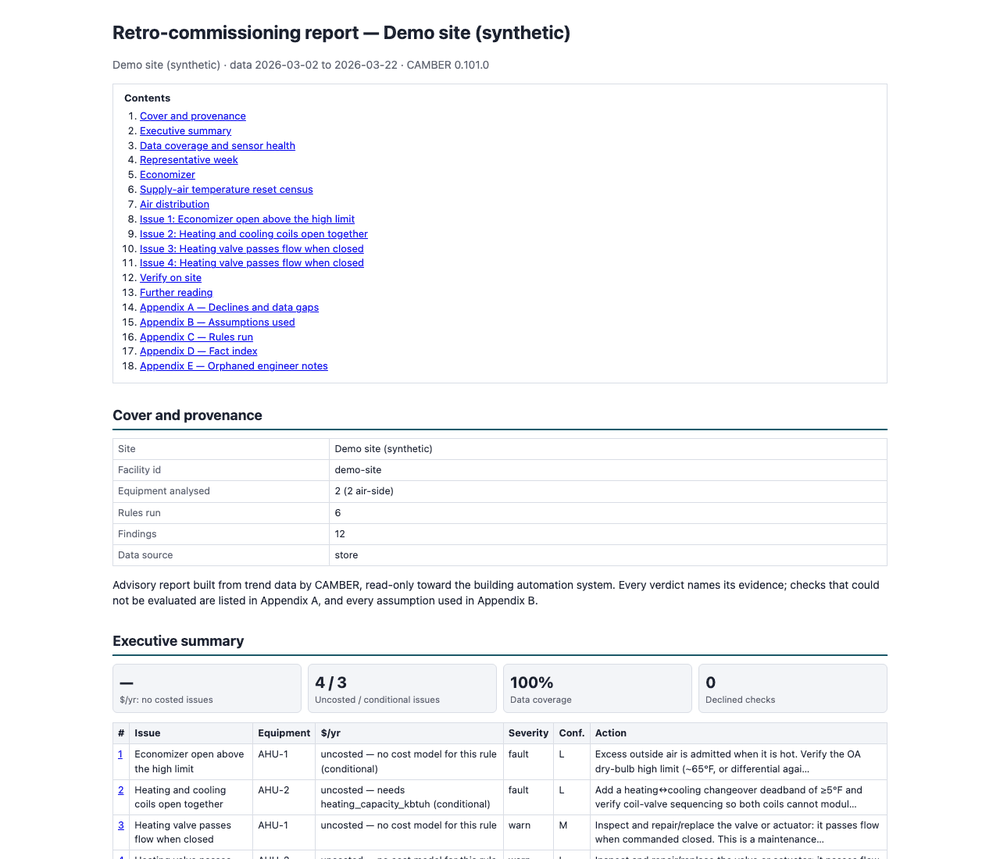

# RCx report layout

`camber report CONFIG --layout rcx` writes the printable **retro-commissioning report**: one HTML
document a commissioning engineer can hand over, print to PDF from any browser, and annotate.
It is a *layout* over the existing analytics — the rules, the evidence engine, the cost estimators
and the action recommendations — and adds no new detector or cost model. The module is
`camber.report.rcx` (provisional, see [API-STABILITY.md](API-STABILITY.md)); the unrelated
`camber.rcx` holds the functional-test / before-after MBCx primitives.

```bash
camber report site.json --out rcx.html --layout rcx
camber report site.json --out rcx.html --layout rcx --week oat-range --paper a4
camber report site.json --out rcx.html --layout rcx --notes notes.json --notes-template slots.json
camber report site.json --out rcx.pdf --layout rcx   # PDF directly (the [pdf] extra, 0.107)
```



*Synthetic data: the opening of an RCx report for a two-AHU demo site: the contents, the cover and the executive summary's KPI strip and issue table.*

`--layout` defaults to the config's `report.layout`, and that defaults to `audit` (the
Std-211 audit report), so existing configs behave exactly as before. Any other name is looked up in
the `camber.reports` [plugin](PLUGINS.md) entry-point group.

## Pages

Every section starts a new printed page; figures and table rows never split across pages, table
headers repeat, and the screen-only table of contents is hidden in print.

| Page | Section | What it holds |
|---|---|---|
| P0 | Cover and provenance | The dataset's source, licence and citation first in the body. Research-only (NC/ND) data gets the non-commercial banner, repeated at the top of **every printed page**. |
| P1 | Executive summary | One page: a KPI strip — costed, non-conditional $/yr; uncosted / conditional issue counts; data coverage; declined checks — and the top-N (default 8) issue table with each issue's $/yr (or `uncosted — needs X`), severity, confidence and a one-line action, linked to its page. |
| P2 | Data coverage and sensor health | The readiness ribbon; the BAS OAT against a reference (when one is configured); a trust table scored **gated** (fan-on samples) and ungated, naming the gate used (`fan status`, `fan speed proxy`, `airflow proxy`, or `ungated — no fan signal`); mixing consistency. |
| P3 | Representative week | The week [selected below](#choosing-the-representative-week), as stacked panels, one unit family each (°F / % / in.w.c.). Values are never normalized. Violation shading covers occupied, fan-on time only. Up to four air handlers are charted, then up to two water-side plants (chilled-, condenser- and hot-water plants) on their own panels (`PLANT_FAMILIES`): water temperatures, loop differential pressure (in the site's own units), electric power and status. A plant has no fan, so its shading covers occupied time. |
| P4 | Economizer | OA fraction vs OAT (temperature balance when MAT/RAT/OAT exist, else damper vs OAT) drawn with **the rule's own** high limit, minimum OA and differential changeover, next to its verdict. Also MAT-between-OAT-and-RAT and a free-cooling table. When an OAT sensor issue exists, a banner says the verdicts are conditional on OAT. |
| P5 | SAT reset census | Three labelled tiers, [below](#sat-reset-tiers). |
| P6 | Air distribution | Duct static by hour of day (fan-on samples only) and any static-reset findings. Omitted when there is no duct static. |
| P7 | M&V and drift | The drift report and the `mv_baseline` results, including declines. Omitted when neither ran. |
| P8+ | One page per issue | Headed by the finding's cause (0.98, #88: "Outdoor-air damper not modulating (stuck low)"), not the remedy; the recommended action keeps its own title ("Recommended action — Repair the outdoor-air damper or actuator: ..."), and the executive summary's Issue column shows the cause. When a member finding names the equipment at fault and the root does not, the member's cause heads the issue (0.100, #101; [precedence below](#which-cause-heads-an-issue)). $/yr with its basis and assumptions; the evidence charts; the members (root first) with the union violation hours; the recommended action; the confidence grade with "why we believe this"; conditional / dependent notes; the engineer's note. |
| — | Verify on site | 0.98 (#88): the walk-down checklist, after the issue pages ([`camber.walkdown`](#verify-on-site), provisional). A lead paragraph links PNNL Re-tuning chapter 9 (Building Walk Down), then one table per kind of item, in walk-down order: **sensors and setpoints** (each sensor a conditional issue leans on, with its trust; a `sensor_drift` issue's sensor; each input a check declined as untrusted), **equipment and controls** (one item per issue from a per-rule, per-cause template), **design values** the checks assumed (a site fact such as a minimum outdoor-air fraction, a high limit or an occupancy schedule left at the rule's default) and **points the checks lacked** (Appendix A's checks not evaluated). Columns: # (linked to the issue; A for Appendix A), Equipment, Look at, Point, Confirms, Refutes. Section id `verify`, engineer-note slot `section:verify`; on by default, omitted when it would be empty. |
| — | Further reading | 0.96 (#78): the [PNNL Re-tuning guides and chapters](REFERENCES.md) relevant to this report's issues only, guides first, as links (nothing reproduced), plus chapter 9 when the report has a Verify on site section. Each issue page also ends its recommended action with **Learn more** links, and `to_dict()` carries each issue's `references` ids. Section id `reading`; no engineer-note slot. |
| A–E | Appendices | A: every decline, caveat, trust-gated decline, missing optional input and unevaluated equipment. B: the assumptions actually used — cost defaults, price, sizing, occupancy source, fan-gate source, week-selection scores. C: rules run and a config hash. D: fact index (reserved). E: orphaned engineer notes. |

## Issues: grouping, dollars and hours

The report ranks **issues**, not findings. `camber.rules.triage.link_findings` groups the findings
on one equipment that share a causal chain (`CAUSE_CHAINS`: the SAT chain from reset to overcooling
to reheat to simultaneous heating and cooling; the economizer chain; the heating-plant lockout
chain, boiler then hot-water pump (0.103); the static-pressure chain),
with the most upstream finding as the root. An issue's key is the root finding's fingerprint, so it
stays the same from run to run.

- **Hours are a union, never a sum.** An issue's violation hours are the union of its members'
  violation masks, gated to fan-on. The "% runtime" figure divides by fan-on hours and says so. Only
  masks a rule derives itself count. When no member has one, the page reads "not measured" rather
  than guessing.
- **A chain's cost is its largest member, never the sum.** The members' estimates price the same
  wasted energy several ways, so the page shows the largest and notes that the estimates overlap.
  Different issues add up.
- **Uncosted is explicit.** An issue with no costed member shows what the estimator needs
  (`uncosted — needs heating_capacity_kbtuh`). Sizing comes from `report.loads`.
- **Excess outside air is costed (0.107, #195).** `outdoor_air_fraction` and
  `economizer_high_limit` findings are priced by the excess-outside-air estimator (see
  [below](#excess-outside-air-cost)). Both sit in the `econ` chain, so the issue shows the larger
  of the two.
- **Rank**: severity tier; then non-conditional before conditional; then costed before uncosted;
  then $/yr, largest first. Uncosted issues of one tier then rank by confidence, H before M
  before L (0.102, #112), so the issue with the most trustworthy evidence leads when no dollars
  separate them. Ties break on the key, so the order is deterministic.

**Sensor precedence.** A sensor problem is derived from the data. It is one of three things: a
`sensor_drift:<role>` finding at warn or fault; an untrusted or stuck trust verdict on the gated
samples; or a mixing-consistency violation. Any finding whose rule reads that role
(`roles_required` or `roles_optional`) on the same equipment becomes **conditional**. For a shared
role like OAT, that covers every equipment that uses it. A conditional issue is annotated and
demoted, never deleted. Its dollars move to "at risk pending sensor fix", and it is listed as a
dependent on the sensor issue's page.

**SAT compliance and G36.** Some `supply_air_reset_compliance` findings are judged against the G36
default map because no site sequence is known. Those findings are shown as a reference only. They
are left out of the dollar totals, and their confidence is L. A declared sequence re-judges them
against the site's own map.

**Air side and plant links (0.91).** The air-side pages (economizer, SAT reset census, air
distribution) cover air handlers only: a VAV box's discharge air, a heat pump's or a fan coil's is
not an AHU's (`camber.model.equipclass`; an unrecognised class keeps the roles test). When a
chilled-water plant is short of setpoint (`chw_supply_tracking`) in the same hours an air
handler's supply air runs warm (`supply_air_control`, G36 FC13), the AHU issue carries the plant
as an upstream cause (`Issue.upstream_causes`): its page opens with an "Upstream cause: plant
short of setpoint" banner, its recommended action (on the page and in the summary) starts with the
plant, and a "why" line says to check plant capacity before the coil valve. The G36 link reads the
`g36_afdd` finding's `flagged_fcs` for FC13 (supply air too warm with the cooling valve full open);
FC12 and FC1 are not plant-capacity symptoms. Since 0.92 the same-hours
test for a G36 finding uses **FC13's own hours** (the rule's evidence carries one mask per fault
condition, `Evidence.masks`), not the union of every fault condition it reported, so duct-static or
economizer hours no longer count as plant symptoms; `UpstreamCause.unit_hours` records `"FC13"` (or
`"finding"` when only the whole mask was available). The plant issue lists the findings it may explain
(`Issue.downstream`). A config `topology` ([TOPOLOGY.md](TOPOLOGY.md)) decides which plant
serves which unit; without one the site's plant is assumed and the line says so.

**AHU-to-VAV cause chains (0.107, #196).** A high supply-air temperature at an air handler and
widespread "zone can't cool" findings at its boxes are one problem, so they are one issue. When
the config declares a served-by `topology`, an AHU finding roots an issue, and the matching
findings on the boxes the topology says it serves become its members. The page opens with a
"Cause chain" banner ("supply air too warm at AHU-1 → zones can't cool on 14 of 22 boxes it
serves"), and the member table marks each box row with its box. The Equipment cell, on the page
and in the summary, reads "AHU-1 + 14 of 22 boxes". The count is out of every box the topology
lists under the air handler. Only the first two box members get evidence charts, and the table
lists all of them. The pairs are a small, explicit table (`camber.rules.triage.ZONE_CHAINS`), and
each test reads the rules' own metrics:

| Chain | AHU-side root | Box-side symptom |
|---|---|---|
| `sat_high` | `supply_air_control` with too-warm leading; `g36_afdd` FC13; `sat_reset_effectiveness` not responding (parked warm under demand) | `unmet_setpoint_hours` with too-hot leading |
| `sat_low` | `supply_air_control` with too-cold leading; `supply_air_reset` (warns only when SAT is held cold); `supply_air_reset_compliance`; `sat_reset_effectiveness` not trimming (and not also parked warm) | `overcooling_min_flow`, `overcooling_severity`, `reheat_penalty`, `reheat_minimization_g36` |
| `static_low` | `g36_afdd` FC1 (duct static too low at full fan); `static_reset_effectiveness` not responding | `airflow_tracking` with under-setpoint leading; `unmet_setpoint_hours` with too-hot leading (a starved box can't cool) |

A box finding joins the first chain, in table order, whose root sits on an air handler that
serves the box. The chain's dollars and hours follow the rules above: its cost is the largest
member, never the sum, so boxes that were priced one by one count once, and its hours are the
union of the members' masks. A box symptom joins only when its hours coincide with the root's.
Each side's mask must cover at least a quarter of the other's, and a G36 root is read on its own
FC13 or FC1 hours. When a side has no mask, the box joins and the "why" line says the overlap was
not assessed. Some symptoms stay their own issues and are counted on the link: a symptom out of
the root's hours, and a symptom that leans on a distrusted sensor. An AHU finding that leans on
one roots no chain. A SAT or static reset that does not reset also links to the rogue zones a
fleet rogue-zone census names (`ZONE_ROGUE_LINKS`). The census is one finding over many air
handlers, so it is listed on each air handler whose boxes it names, and it stays its own issue.

Nothing is guessed. Without a declared topology, nothing is linked. A naming guess (provenance
`heuristic`) is not used. A box the topology does not cover is not linked either, and Appendix A
names those boxes ("AHU-to-VAV cause chains not linked (missing topology)"). A box served by
another air handler stays separate. `Issue.zone_links` holds the links (`ZoneLink`: the chain,
the air handler, the boxes, the boxes served, and the boxes kept out), and `to_dict()` issues
carry them as `zone_chains`. The `synthetic-g36-vav-fleet` run template declares its topology,
but its rules form no chain. The air handler whose resets fail (`not_responding`) has no box
symptom among the template's rules, and the rogue boxes sit under air handlers whose resets are
effective.

**G36 advice needs a declared G36 sequence.** A recommended action that prescribes a Guideline 36
sequence is given as the fix only when the config declares one for the unit: a `soo` entry with a
`g36_*` library for its class (a terminal unit counts when its air handler's class, `AHU`, has one).
Otherwise a check that assumes a G36 sequence (a rule named `*_g36` or `g36_*`) gets no packaged
action ("engineer to specify"), and any other action worded as G36 practice is labelled a G36
reference, to be checked against the unit's own sequence first.

### Which cause heads an issue

0.100 (#101). An issue's heading is a cause, read from one finding's recommendation. Some causes
are **equipment-level**: they name a component that does not do what it is told. These are a
damper that does not deliver the outside air it is commanded to (`free_cooling_missed` with
`missed_cause` `damper_not_delivering`), a reheat valve whose position does not follow its demand
(`reheat_penalty` at or above the valve-divergence share), a leaking valve (`leaking_valve`), a
stuck actuator (`actuator_stuck`) and a drifting OA damper (`economizer_damper_drift`). The cause is
read as the walk-down reads it (`camber.walkdown.cause_key`). Other causes name a symptom or a
sequence problem: outside air below the minimum, excess outside air, a reset that does not reach
its end. The heading follows this precedence:

1. A root whose own cause is equipment-level keeps the heading.
2. Otherwise, the first member in the chain's root-first order (the most upstream) whose cause is
   equipment-level, and whose recommendation names it, heads the issue.
3. Otherwise the root's cause heads it, as before.

The action, its title, its suggested value and its Learn-more links stay the root's in every case.
When a member's cause leads, the page says so in one line above the recommended action ("Cause
from the free_cooling_missed member, which names the equipment at fault (the root finding reads:
...)"). `to_dict()` issues carry the heading's `cause` and, from 0.100, `cause_rule`: the rule of the
finding that names it. The executive summary uses the same heading. For example, an air handler
whose outside air is below its minimum (`outdoor_air_fraction`, the root) while its damper is
commanded open in mild weather and delivers 5 % outside air (the `free_cooling_missed` member) is
headed "Outdoor-air damper not modulating (stuck low)", and its action stays "Restore minimum
outside air". On the catalog run templates two issues are re-headed this way. Since 0.100 the
`lbnl-ddahu` and `lbnl-sdahu` templates run `free_cooling_missed`. `lbnl-ddahu` `DMPRStuck_OA_0`
now reads "Outdoor-air damper not modulating (stuck low)". `lbnl-sdahu` `damper_stuck_075` reads
"Outdoor-air damper not modulating (stuck part open)", where its root, `economizer_high_limit`,
reads "Economizer open above the high limit". Since 0.101 (#108) the walk-down's equipment item
follows the same cause (see [Verify on site](#verify-on-site)).

## Verify on site

`camber.walkdown.site_checks` (provisional, 0.98) builds the checklist from what the report
already knows; it adds no detector. Each item says what to look at on site, which point to
compare, and what result would **confirm** the finding (or the flagged problem) and what would
**refute** it. Every item links PNNL Re-tuning chapter 9 (`WALKDOWN_REFERENCES`); nothing from the
chapter is reproduced, and the item texts are CAMBER's own.

- **Sensors.** A conditional issue's sensor causes (`Issue.conditional_on`), one item per role,
  with the gated trust score; a setpoint role asks for the value at the controller and the trend
  mapping, a sensor role for a reference instrument and the mapping. Sensors come first: a wrong
  sensor can make any finding that uses it wrong.
- **Equipment.** `SITE_CHECKS[rule][cause]`, with the cause read from the finding's metrics the
  way the recommender reads them (`CAUSE_KEYS`): `free_cooling_missed`'s `missed_cause` (a damper
  that does not deliver is a blades-and-linkage check, an economizer that is never commanded a
  controller check), `chw_plant_reset`'s reset direction and flow mode, a pump pinned at a VFD
  floor CAMBER inferred (`near_min_source`), the reheat valve whose position diverges from its
  demand, and so on. A rule without a template gets a generic item built from its required
  inputs. The item follows the cause that heads the issue (0.101, #108): when a member's cause
  heads it ([Which cause heads an issue](#which-cause-heads-an-issue)), the report passes that
  rule and cause key to `site_checks(heading_causes={issue key: (rule, cause key)})`, and the item
  is the member's template, with that rule's references; otherwise it is the root's. On the 15
  catalog run templates this changes 2 of 98 issues' items, the two re-headed ones: `lbnl-ddahu`
  `DMPRStuck_OA_0` (from the minimum-outdoor-air damper position to the outdoor-air damper's
  blades, linkage and actuator) and `lbnl-sdahu` `damper_stuck_075` (from the damper on a hot
  hour against the high limit to the same blades-and-linkage check).
- **Design values.** `DESIGN_PARAMS` names the site facts a rule assumes (not its detection
  thresholds). An item is listed when the issue's rule ran with that parameter at its default
  (not named in the config's `rules[].params`): confirm it against the drawings or the
  controller, and set it in the config if it differs.
- **Data.** `RunResult.rules_skipped` (`missing_inputs`, `no_data`), grouped like Appendix A:
  is the point on the controller but not trended or mapped, or does the equipment not have it?

Duplicates (same kind, equipment and point) are listed once, under the first issue that needs
them.

## Confidence

Each issue gets H, M or L: the **minimum** over the components below. Each component writes one
"why we believe this" line.

| Component | H | M | L |
|---|---|---|---|
| Input trust (gated) | every input `trusted` | one `suspect` | one `untrusted`, or the issue is conditional |
| Mapping | roles recorded at ingest (store source) | a config tag-to-role mapping | a point looks like a percent signal mapped to a flow role |
| Assumptions | the rule's parameters come from the site config | rule defaults | a reference the site never declared (G36 default with no sequence) |
| Sample / coverage | at least 168 samples judged and full input coverage | at least 48 samples, or coverage below 80 % | fewer samples, or coverage below 50 % |
| Corroboration | the rule scores TPR ≥ 0.9 and FPR ≤ 0.05 on the synthetic benchmark | scored, but lower | — |

A component that cannot be assessed is left out of the minimum, and its line says so.

## Choosing the representative week

`select_week` is deterministic, and its explanation is built only from the numbers it reports.

1. The candidates are the Monday-00:00 7-day windows, in the data's local clock.
2. A window is **eligible** when the charted roles cover at least 80 % of its gated (fan-on)
   samples and it has at least 3 occupied days. The week is scored on the air handlers' air-side
   roles (`P3_FAMILIES`). A report with no air handler (a chiller or boiler plant on its own) is
   scored on its plants' roles (`PLANT_FAMILIES`) instead, ungated when a plant has no fan signal;
   on a mixed site the plants are charted in the air handlers' week. When no window is eligible, the report declines to
   chart a week and says why.
3. Each window is scored by the chosen mode, plus `0.1 × coverage`:
   - `evidence` (default, and `auto`): the sum over issues of
     `(1/rank) × (gated violation hours in the window / the issue's total)`. Conditional issues
     count half.
   - `oat-range`: the share of the period's OAT deciles present in the window, plus 1 when the
     window crosses the economizer high limit.
   - `typical`: minus the RMS distance of the window's daily-mean OAT from the period's median
     daily mean.
   - `YYYY-MM-DD` (or `fixed:YYYY-MM-DD`): the window containing that date.
4. Ties go to the earliest week. The explanation reads like "Chose the week of 2018-02-26 by
   evidence: score 0.126 = evidence 0.026 + 0.1 x coverage 1.00; 4 occupied days; runner-up week of
   2018-03-05 scored 0.126 (tie -> earliest); 52 of 53 candidate weeks eligible." Appendix B lists
   every window's score.

## SAT reset tiers

| Tier | When | What P5 shows |
|---|---|---|
| 1 | A SAT setpoint is trended | Tracking error (mean \|SAT − SP\| and the share of fan-on, occupied samples off by more than 2 °F) plus the setpoint vs OAT |
| 2 | A site sequence is declared (`report.rcx.sequence.sat_reset`, or the config's `soo` spec) | A census: the share of fan-on, occupied hours outside the declared band, drawn as a reset-line scatter |
| 3 | Neither | SAT vs OAT and the `analyze_satreset` descriptors. The **verdict is declined** ("no site sequence known"). A G36 line appears only with `g36_reference: true`, labelled "reference, not a verdict". |

## Engineer notes

The notes file is JSON keyed by slot:

```json
{
  "exec_summary": {"text": "Walked the site on 3/30.\n\nAll AHUs ran.", "author": "A. Engineer", "date": "2026-03-30"},
  "section:week": "The chosen week matches the complaint log.",
  "issue:5e97d850de5d": [{"text": "Damper linkage replaced.", "author": "Tech", "date": "2026-04-02"}]
}
```

A note is a string, a `{"text", "author", "date"}` object, or a list of either. Text is escaped and
split into paragraphs on blank lines. Each note renders as "Engineer's note — author, date". An
`issue:<fingerprint>` key follows the issue across runs. A key that matches no slot in this report
goes to Appendix E, so a note on a resolved issue is never silently lost. `--notes-template
slots.json` writes an empty entry for every slot. `--lifecycle` also pulls each issue's
`FaultRecord.notes` from the fault store: the facility-keyed `state/<facility_id>/faults.json` in a
[portfolio workspace](PORTFOLIO.md), or the config's `faults.store`.

## Configuration

```json
"report": {
  "layout": "rcx",
  "loads": {"AHU-1": {"heating_capacity_kbtuh": 400, "fan_kw": 15}},
  "rcx": {
    "top_n": 8, "week": "evidence", "paper": "letter", "chart_format": "png",
    "sections": ["cover", "summary", "data", "week", "economizer", "sat", "air", "mv", "issues", "verify", "reading", "appendix"],
    "price": {"electricity_per_kwh": 0.14, "gas_per_therm": 1.10},
    "occupancy": {"start_hour": 6, "end_hour": 20, "days": [0, 1, 2, 3, 4, 5]},
    "oat_reference": {"csv": "weather/oat_reference.csv"},
    "sequence": {"sat_reset": {"oat": [50, 70], "sat": [60, 55], "tol_f": 2}},
    "notes": "notes.json"
  }
}
```

- `report.loads` (or `report.rcx.loads`) sizes equipment for the existing cost estimators.
  For the excess-outside-air estimator a unit takes `supply_airflow_cfm` (or `design_oa_cfm`,
  the design minimum outdoor airflow) and, when a heat pump heats it, `heat_pump_cop`. A
  site-wide `heat_pump_cop` can go in `report.rcx.cost_params` instead.

### Excess outside air cost

The estimator (`camber.fault_economics`, 0.107, #195) prices only the outside air **above the
declared minimum**, on the samples the rule judged: occupied, fan-on and with a stable mixing
balance. A sample is priced when its OA fraction is above `min_oa_pct` plus the rule's 5-point
margin. The excess priced is `e = (OAF - min) / 100` of the supply air. Each priced sample is then
classed by what the extra outside air does:

| Condition | Read as | Rate (Btu/h) |
|---|---|---|
| OA enthalpy above return-air enthalpy (outdoor RH and return RH or dew point trended) | cooling | `4.5 × cfm × e × (h_OA − h_RA)` |
| OAT above RAT, no humidity trended | cooling | `1.08 × cfm × e × (OAT − RAT)` |
| OAT below RAT while the unit heats (heating valve above 5 %, else SAT more than 2 °F above MAT) | heating | `1.08 × cfm × e × (RAT − OAT)`, capped at the coil's `1.08 × cfm × (SAT − MAT)` |
| OAT below RAT and the unit not heating | economizing | 0 (free cooling is not a penalty) |
| OAT below RAT, no heating valve and no SAT | not judged | 0, and the reason is reported |

1.08 and 4.5 are the standard-air factors: 0.075 lb/ft³ × 60 min/h × 0.24 Btu/lb·°F = 1.08, and
0.075 × 60 = 4.5 lb/h per cfm. Enthalpy is `h = 0.240 t + W (1061 + 0.444 t)`. The humidity ratio
`W` comes from RH (or dew point) with the Hyland-Wexler saturation pressure at 14.696 psia. These
are the ASHRAE Handbook—Fundamentals psychrometric relations. The method follows the PNNL
re-tuning guides on minimum outdoor air and economizer operation (`pnnl-guide-min-oa`,
`pnnl-guide-economizer`).

- **Airflow:** the trended supply airflow when the unit has a plausible one (a 95th percentile
  above 100 cfm, present on at least 90 % of the priced samples). Otherwise
  `loads.<unit>.supply_airflow_cfm`, otherwise `design_oa_cfm / (min_oa_pct / 100)`.
- **Annualised:** the period's energy × `annual_hours` (8760 by default) / the hours of data
  observed.
- **Priced:** cooling as electricity at `cool_cop` (3.5); heating as gas at `boiler_efficiency`
  (0.80), or as electricity at `heat_pump_cop` when it is set.
- **Verdict first:** only a warn or fault excess-OA verdict is priced. An `ok` or
  under-ventilated unit costs nothing.
- **Declines name the input:** `uncosted — needs supply_airflow_cfm or design_oa_cfm`, or
  `needs min_oa_pct` when the rule's minimum is its generic 20 % (`min_oa_source: "default"`) or
  the lockout rule has none. The lockout rule also declines when it judged on damper position
  (`needs mixed_air_temp and return_air_temp`).

Appendix B lists each actionable OA finding's minimum and its source, the airflow source, the
cooling and heating bases with their hours and efficiencies, and the estimate or the input it
needs. The finding's `oa_cost_*` metrics carry the period's sums. The humidity, supply-air,
heating-valve and occupancy points they read are cost-only inputs (`roles_cost`): they never change
a verdict, and they are not listed as missing inputs.
- `oat_reference` is offline by default (a CSV of time and °F). To fetch NASA POWER instead, opt in
  with `{"fetch": "nasa_power", "latitude": …, "longitude": …, "tz": "America/Chicago"}`.
  Every distinct OAT source is compared (0.91): units reading one sensor
  share a row, and an AHU trending its own sensor gets its own row and `sensor_drift:oat` finding,
  which makes only that unit's findings conditional. Without a reference
  (0.92, #66), the site's OAT sources are cross-checked against each other: with three or more,
  each against the site median (one wrong sensor is out-voted and gets a scoped
  `sensor_drift:oat` finding, `metrics["reference"] = "peer_median"`); with exactly two, their
  disagreement is shown in the data section but raises no finding, since it cannot say which one
  is wrong. Plant points (chilled-, condenser- and hot-water temperatures) are judged for trust on
  their equipment's running samples (see [Sensor health](SENSOR-HEALTH.md)).
- `chart_format: "svg"` renders the line charts as SVG; dense scatters stay PNG.

In Python:

<!-- fence: skip (needs a file) -->
```python
from camber.config import run_config_file
from camber.report import RcxOptions, build_rcx_report

run = run_config_file("site.json")
rep = build_rcx_report(run, options=RcxOptions(week="oat_range", paper="a4"))
open("rcx.html", "w").write(rep.to_html())
rep.to_dict()  # KPIs, ranked issues, the week choice, sections, notes
rep.slots()  # every note slot id
```

## Printing

Printing needs nothing beyond a browser: open the HTML and print to PDF. The inline print CSS sets
the page size (`letter` or `A4`, from `--paper`), adds page-number margin boxes, starts every
section on a new page and keeps figures and rows whole. It also repeats table headers, forces exact
colours, hides the table of contents, and repeats the research-only banner on every page. The
report uses no JavaScript and loads no external assets: the charts are inline base64 PNG at 150
dpi, or SVG.

### Direct PDF output

Since 0.107 (#197), an `--out` path ending in `.pdf` writes the PDF directly, for unattended
runs:

```bash
pip install "camber-toolkit[pdf]"
camber report site.json --layout rcx --out rcx.pdf --paper a4
```

The PDF is the same HTML rendered by [WeasyPrint](https://weasyprint.org/), so there is one
layout source and the print rules above all hold: `--paper` sets the page size, every section
starts a page, figures and table rows stay whole, table headers and the research-only banner repeat,
and the inline charts are embedded. WeasyPrint is given the HTML with only `data:` URLs allowed,
so the render reads nothing from disk or the network. From Python, `RcxReport.to_pdf(path)`
returns the bytes and writes them when given a path.

The PDF is reproducible: its creation and modification dates are the end of the data period, or
`SOURCE_DATE_EPOCH` (whole seconds since 1970, UTC) when that is set, so the same data gives the
same bytes. A malformed `SOURCE_DATE_EPOCH` exits 2.

**Installing.** The `pdf` extra pins `weasyprint>=68.1`. WeasyPrint also needs the **Pango**
system libraries, which pip cannot install: on Debian or Ubuntu, `apt install libpango-1.0-0
libpangoft2-1.0-0`; on macOS, `brew install pango`; on Windows, see WeasyPrint's installation
guide. Without the extra, or without Pango, `camber report` exits 2 before the run and names
`pip install "camber-toolkit[pdf]"`. **conda-forge users:** the CAMBER feedstock does not pull
WeasyPrint, so install `weasyprint` from conda-forge (`conda install -c conda-forge weasyprint`,
which brings Pango) or with pip.

Only the rcx layout writes PDF; `--layout audit` with a `.pdf` path exits 2. In CI the real PDF
tests run in a separate job that installs Pango; elsewhere they skip.

## Worked example: the LBNL single-duct AHU

The open [dataset catalog](DATASETS.md) ships the LBNL simulated single-duct AHU (CC-BY-4.0, with
labelled faults). Every scenario is one equipment, `AHU__<scenario>`, so an `equipment` entry's
`"equip"` list selects a single scenario:

```bash
camber datasets fetch lbnl-sdahu
camber datasets ingest lbnl-sdahu --store lab_store
camber datasets config lbnl-sdahu --store lab_store --out sdahu.json
# then edit sdahu.json: "equipment": [{"class": "AHU", "marker_role": "mixed_air_temp",
#                                      "equip": ["AHU__fault_free"]}], add rules, and
#   "report": {"layout": "rcx"}
camber report sdahu.json --out rcx_fault_free.html --layout rcx
```

The run below used the default subset, an hourly resample, and seven rules. The rules were
`outdoor_air_fraction` (min OA 20 %), `leaking_valve`, `economizer_high_limit`, `supply_air_reset`,
`supply_air_reset_compliance`, `static_pressure_reset` and `supply_air_control`. It covered the
fault-free scenario and two faulted ones: the OA damper stuck at 25 %, and the cooling-coil valve
leak.

- **Which scenario gets issues.** `AHU__damper_stuck_025` ranks one **fault** first, with
  confidence H: `outdoor_air_fraction` reports under-ventilation, a median OAF of 4 % against the
  20 % minimum, over 1,711 violation hours (36.5 % of 4,682 fan-on hours). The action says to
  restore minimum outside air, not to check the high limit. Its free-cooling table shows 100 % of
  the 3,050 eligible fan-on hours running the cooling coil at ~4 % OA, against 41 % for the
  fault-free run (the fault-free unit keeps its economizer closed with the coil on through much
  of the 40–65 °F band). The fault-free scenario raises no fault. Its three warn issues are
  properties of the simulated sequence: a flat duct-static setpoint, SAT warm of setpoint 12 % of
  running hours, and no SAT reset. The **leak** scenario gets no leak issue: `leaking_valve` sees
  a CHW leak in only 1 % of closed hours, because the dataset maps valves to the controller
  *demand* columns, which hide a leak (a known dataset issue). Its only issue is the SAT reset.
- **Week choice.** Fault-free: "Chose the week of 2018-05-28 by evidence: score 0.146 = evidence
  0.046 + 0.1 x coverage 1.00; 5 occupied days; runner-up week of 2018-09-03 scored 0.143; 52 of
  53 candidate weeks eligible." Stuck damper: the week of 2018-02-26 (score 0.126), tied with
  2018-03-05 and broken to the earlier week. Leak: no issue carries a violation mask, so every
  week scores 0.100 and the earliest (2018-01-01) wins -- `--week oat-range` is the better
  choice there. The last "week" of 2018-12-31 is a single day, so it is ineligible.
- **No G36 verdict without a sequence.** The unit trends a fixed 55.2 °F SAT setpoint, so P5 is
  tier 1 (stuck damper: 0.1 °F mean tracking error, 3 % of 2,221 gated samples off by more than
  2 °F). The G36-default `supply_air_reset_compliance` warning ("below target 66 % of hours") is
  shown on the issue page as `[G36 default target, not the unit's trended setpoint (reference
  only)]`, marked `excluded` from the $/yr, and drawn without an evidence chart.
- **The SAT reset shape is fan-gated.** With the fan off, the "supply" sensor reads unconditioned
  air; before the gate those samples added a 65–78 °F band to the SAT-vs-OAT cloud. Gated, the
  stuck-damper fit is slope +0.000 °F/°F, SAT std 0.76 °F over 2,221 samples (ungated: +0.015,
  2.25 °F over 2,274); the verdict is unchanged ("NO RESET, SAT pinned low at ~55 F").
- **No stuck sensors counted during fan-off.** The trust table is gated on `fan status`. No point is
  flagged stuck, gated or ungated. At an hourly resample the fan-off stretches do not form long
  identical runs, so on this dataset the gate did not change a trust verdict.
- **Economizer charts match the verdicts.** `economizer_high_limit` judges fan-on samples with the
  rule's defaults (65 °F, differential on, a 55 % excess threshold because the design minimum is
  unknown); the caption lists what it could not judge (stuck damper: 884 hot fan-off samples,
  480 with |OAT − RAT| < 5 °F, 4 outside −20…120 %). The charts show 0 % out of band, as the `ok`
  verdicts say. `outdoor_air_fraction` is fan-gated by default too (since 0.86, with the unit's
  trended occupancy and its own design minimum), so its issue-page chart draws the fan-on,
  occupied samples behind the two percentages in the finding; with a seasonal minimum
  (`min_oa_pct_by_month`) the chart plots each sample against its own month's minimum.
- **Night duct static.** The box-by-hour shows 4–5 in.w.c. at hours 0–5 and 23, each box labelled
  with 1–4 samples: the simulated unit night-cycling in cold weather (-6 to 16 °F OAT) against
  closed boxes, not a gating or timezone error.

Each run builds in about 2.5 s (8,759 hourly samples).
