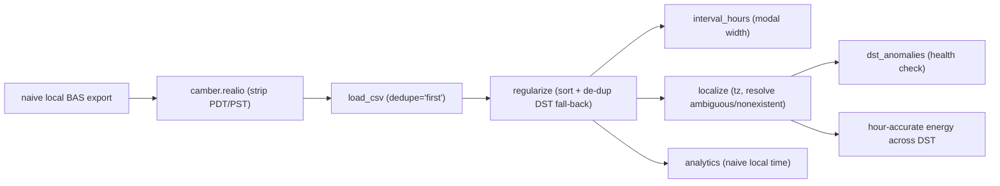

# Time handling & DST

BAS trend exports arrive as **naive local time** (`camber.realio` strips the `PDT`/`PST`
abbreviation), so daylight-saving transitions leave two artifacts: the **fall-back** hour repeats
(duplicate timestamps) and the **spring-forward** hour is missing (a gap). Concatenated overlapping
exports duplicate timestamps too. `camber.timegrid` centralizes robust handling.



*Duplicate/gap DST artifacts are collapsed on ingest; timezone is attached only when hour-accurate energy needs it.*

```python
from camber.timegrid import interval_hours, regularize, localize, dst_anomalies

interval_hours(series.index)  # modal width, ignores 0/duplicate gaps
clean = regularize(
    df, dedupe="first"
)  # sort + collapse duplicate timestamps ("first"/"last"/"mean")
aware = localize(
    idx, "America/Los_Angeles"
)  # tz-localize, resolving DST ambiguous/nonexistent times
dst_anomalies(
    idx, "America/Los_Angeles"
)  # {"duplicate_timestamps", "fallback_ambiguous", "springforward_nonexistent"}
```

- **`interval_hours`** uses the median of strictly-positive gaps, so a duplicate (0-gap) timestamp
  can't collapse the interval to zero (which would zero out any energy computed from it).
- **`regularize`** sorts and de-duplicates — `"first"`/`"last"` keep one row, `"mean"` averages the
  repeated hour, `None` leaves duplicates.
- **`localize`** attaches a timezone to naive local data, mapping the fall-back repeated hour to
  PDT→PST and shifting the spring-forward skipped hour forward (rather than raising).
- **`dst_anomalies`** counts duplicates and, given a timezone, the fall-back/spring-forward
  transitions — a DST health check for a series.

**Wired into ingest:** `camber.io.load_csv(..., dedupe="first")` now collapses duplicate timestamps
by default, and `camber.ingest.quality.assess` reports `n_duplicate_ts`. The robust outlier detector
also no longer crashes on a non-unique (duplicate-timestamp) index.

**Order matters for the two-regime read.** `assess`'s temporal-coherence gate measures run lengths
**in index order**, so an unsorted export can make a real duty cycle look like scatter (and be
scored pooled, the conservative direction). Run `timegrid.regularize` — sort + de-duplicate —
before `assess` on any export whose ordering you don't control.

**Still local time:** analytics operate on naive local time (correct for occupancy/schedule logic).
For hour-accurate energy across a DST-transition day, `localize` to a tz first, or note the ~1-hour
difference on those two days a year.

## Stamps that name an instant: the site time zone

Some exports stamp **instants** instead of local wall-clock readings: ISO 8601 with a `Z` or
`+hh:mm` offset (an open-data package's `timestamp_utc`, an OPC-UA `SourceTimestamp`), a trailing
`UTC` / `GMT`, or epoch seconds. CAMBER's analytics run on local time, so such stamps must be
converted to the site's zone first. Before 0.90.1 the offset was dropped without converting: at a
US Central site a fan that ran 07:00-16:00 appeared to run 12:00-21:00.

Pass the site's IANA zone to the parser, a loader or an adapter, or set it once in a config:

```python
from camber.io import load_csv

df = load_csv("export.csv", timezone="America/Chicago")  # Z / offset / epoch -> Chicago wall clock
```

```json
{"source": {"kind": "perpoint_csv", "folder": "trends/", "timezone": "America/Chicago"}}
```

- Offset-bearing and epoch stamps are converted to the site's wall clock and then made naive.
  Mixed offsets (a `-06:00` / `-05:00` export across a DST switch) parse as the instants they are.
- Naive stamps are taken to be local already (or in `assume_tz`, and converted from it).
- After conversion the DST fall-back hour repeats and the spring-forward hour is absent, exactly
  as in a naive local export: `regularize` (the loaders' `dedupe`) collapses the repeat.
- **Without a zone** the clock is kept as written (UTC for `Z`), for back-compat, and a
  `camber.tsparse.TimezoneWarning` says that schedule, occupancy and hour-of-day rules will be
  shifted. `strict_timezone=True` (config `source.strict_timezone`) refuses such data instead.
- A store facility ingested from the dataset catalog is already on the site's clock (the entry's
  `source_timezone` / `local_timezone`). There `source.timezone` defaults to that zone and applies
  only to a `shared_oat` CSV file, and a different zone warns.

## M&V frames across daylight saving

The M&V frame builders in `camber.mandv.intervalfit` take the site's zone as `timezone=` (a
config's `source.timezone`). See [MANDV.md](MANDV.md#daylight-saving-days-provisional-093) for the
energy side.

- **Daily** (`daily_energy_vs_temp`, 0.93): a day is as long as its clock. The fall-back day sums
  25 hours (a sample in the repeated hour counts for both passes, `repeated_hour_weights`) and the
  spring-forward day 23. The day-coverage rule (0.105, `min_coverage`) judges each day against
  that length; without a zone every day is 24 hours.
- **Hourly** (`hourly_energy_vs_temp`, 0.105): with a zone the samples are placed on their real
  instants, `localize`'s convention. The repeated hour becomes two hours, both kept, and the frame
  has a tz-aware local index. A lone sample in the repeated hour (the store's hourly mean of the
  two passes) stands for both. Without a zone, duplicate timestamps are one hour: energy and
  temperature are averaged per stamp (`regularize(dedupe="mean")`), so the repeated hour is no
  longer counted double. A `TimezoneWarning` gives the count, as for offset stamps without a zone.
- A rate meter's step comes from the positive gaps only (as `interval_hours` does), so duplicate
  stamps can no longer pull it to zero.

## Resampling a run status

A run config's `resample` (default `1h`) puts every point on one grid. Analog points take the
bin's mean. A run status or command (`boiler_status`, `supply_fan_status`, `pump_status`,
`compressor_status` and the other status roles) takes the bin's mean as well, which for a 0/1
signal is its **duty**: the share of the bin it was on (0 to 1). The rule is the same at every
step: ingest's 15-minute resample, the folder path (`camber.realio.load_status(how="duty")`, time
weighted over an event-logged point) and a run's read from a Parquet store, through
`camber.resolve` or `ParquetStore.read_role_frame(resample=...)`. The only exceptions are the
warm-up and cool-down flags (`warmup`, `cooldown`), which take the bin's max: they *exclude*
samples, and a bin touched by warm-up at all is excluded whole.

Why a duty and not the max ("on at any moment of the bin")? The duty keeps strictly more: "on at
any moment" is `duty > 0`, but a max cannot give back how long the equipment ran. A max would
read a boiler firing 15 minutes an hour as firing the whole hour, inflating every run-time figure,
and it would not help a start count either: an hour with any firing in it reads on, so a boiler
that cycles all day reads as one long run.

What the rules read from a duty:

| Question | Read | Used by |
|---|---|---|
| How long did it run? | the duty itself (its mean, or duty-weighted shares) | `runtime_pct` of the start-counting rules; `boiler_running_pct` and `summer_run_pct` of `boiler_summer_lockout`; `pump_running_pct`, `summer_run_pct` and `boiler_off_pct` of `hw_pump_summer_lockout` from a pump status (0.105; a speed or flow stand-in has no duty and reads 0/1 against its running cut); `night_weekend_setback` |
| Was it running in this sample, to judge the other points of the sample? | duty > 0.5 (on for most of the sample) | the fan, pump and plant gates (`camber.schedules.fan_on_mask`, `plant_run_mask`); the loop delta-T and reset checks |
| How many times did it start? | the fewest starts consistent with the duties | `boiler_short_cycle`, `compressor_short_cycle` |

A sample-level gate at 0.5 never turns a mostly-on sample off or a mostly-off sample on: the
analog points of a sample on for a quarter of it are mostly the off readings, so the gate leaves
them out.

**Counting starts on a coarse trend.** A start count can only see a cycle as long as the trend's
interval. The start-counting rules count the fewest starts the duties allow (a sample on for part
of its interval holds a start or a stop inside it), which on a plain 0/1 trend is the off-to-on
count. On a trend coarser than the rule's `max_interval_min` (default 15 minutes; see
[THRESHOLDS.md](THRESHOLDS.md)) that count is a floor:

- at or above `max_starts_per_day` the verdict stands (the floor already reaches the limit), with
  a caveat;
- below it, when samples show the equipment on for only part of an interval, the interval hid
  starts, so the rule declines (`info`, "cannot confirm") instead of reporting `ok`;
- below it with no part-on samples, `ok` stands with the caveat.

`chiller_staging` counts starts from an averaged power trend, which has no part-on reading to show
hidden cycles; coarser than its `max_interval_min` it adds the caveat only. Run start-counting
rules at the interval the data was stored at (`resample: 15min` for a catalog dataset) to count
the cycles themselves.
