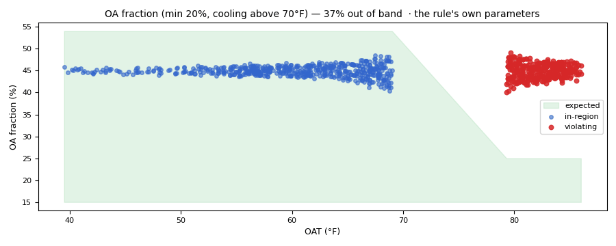

# What excess outside air costs

*Workbook exercise `air-excess-oa-cost` · PNNL re-tuning chapter 6 · about 45 minutes*

## Goal

Find an air handler that holds more outside air than its design minimum, and put a price on it.
Follow the estimate through the three things extra outside air can do: cost cooling in hot or
humid hours, cost heating in cold ones, and cost nothing while the unit economizes. Then see what
the estimate needs from you, and what it does when an input is missing.

## Learn more

Read these first (PNNL, free):

- [AHU Minimum Outdoor-Air Operation][pnnl-guide-min-oa]: how to find a minimum outside-air
  setting that is too high, and why the minimum damper position is not the outside-air fraction.
- [Air-Side Economizer Operation][pnnl-guide-economizer]: when outside air above the minimum is
  free cooling and when it is a load, and the high-limit choices that decide it.
- [Chapter 6: Economizer Operations][pnnl-retuning-ch6] of the re-tuning training, for reading
  the mixed, return and outdoor air trends together.

[pnnl-guide-min-oa]: https://www.pnnl.gov/sites/default/files/media/file/pnnl_sa_88958.pdf "Building Re-Tuning Training Guide: AHU Minimum Outdoor-Air Operation (PNNL-SA-88958)"
[pnnl-guide-economizer]: https://www.pnnl.gov/sites/default/files/media/file/pnnl_sa_86706.pdf "Building Re-Tuning Training Guide: Air-Side Economizer Operation (PNNL-SA-86706)"
[pnnl-retuning-ch6]: https://www.pnnl.gov/sites/default/files/media/file/ch6_economizer.pdf "Large Commercial Buildings: Re-tuning for Efficiency, chapter 6: Economizer Operations: Pre-Re-Tuning and Re-Tuning (PNNL-SA-85063)"

## Datasets and licence

- **`synthetic-ahu-excess-oa`**: two **synthetic** variable-air-volume air handlers that CAMBER
  generates on your computer. Nothing is downloaded and no real building is behind them. They
  trend the outdoor and return air temperature and relative humidity, the mixed and supply air
  temperatures, the supply-air setpoint, the outdoor-air damper, the supply airflow, the heating
  and cooling valves, the fan status and the occupancy point, every 15 minutes for six weeks of a
  humid spring turning to early summer. Licence **Apache-2.0** (CAMBER's own; the data may be
  shared). About 0.7 MB. See [synthetic datasets](../DATASETS.md#synthetic-datasets) for how
  CAMBER generates it.

The facility `ds-synthetic-ahu-excess-oa` holds three equipment: `AHU__excess_oa`,
`AHU__economizer`, and `AHU__excess_oa_no_flow`, which is `AHU__excess_oa`'s data read without
its supply airflow point, as a BAS with no airflow station would trend it. Both units declare a
20 % design minimum outside air. How each one runs is for you to find.

## Setup

### In the lab

1. Run `camber lab` and open the URL it prints (`http://127.0.0.1:8765/lab?token=...`).
2. Tick `synthetic-ahu-excess-oa` (its kind reads `synthetic`) and press **Fetch & ingest**.
   CAMBER generates the file instead of downloading it, then ingests it like any other dataset.
3. When the job is done, the row links to **trends** (the trend viewer) and to **report**. The
   cost is in the RCx layout, which the steps below build on the command line.

### On the command line

```
camber datasets fetch synthetic-ahu-excess-oa
camber datasets ingest synthetic-ahu-excess-oa --store lab_store
camber datasets config synthetic-ahu-excess-oa --exercise air-excess-oa-cost --store lab_store --out oa.json
camber run oa.json --out oa_out
camber report oa.json --layout rcx --out oa_rcx.html
camber datasets score synthetic-ahu-excess-oa --store lab_store --findings oa_out/findings.json
```

The exercise's config runs `outdoor_air_fraction` with the units' declared minimum
(`min_oa_pct` 20) and `economizer_high_limit` with the same minimum and the economizer's 65 °F
dry-bulb high limit; read its `_comment`. Two variants change one input each: no declared
minimum, and a design outdoor airflow for the unit without an airflow point:

```
camber datasets config synthetic-ahu-excess-oa --exercise air-excess-oa-cost--no-min --store lab_store --out oa_nomin.json
camber report oa_nomin.json --layout rcx --out oa_nomin_rcx.html
camber datasets config synthetic-ahu-excess-oa --exercise air-excess-oa-cost--design-oa --store lab_store --out oa_design.json
camber report oa_design.json --layout rcx --out oa_design_rcx.html
```

For step 5, the same unit without its humidity points, in Python:

<!-- fence: skip (needs a store) -->
```python
from camber.fault_economics import cost_findings
from camber.model.roles import Role
from camber.rules.oafraction_rule import OutdoorAirFraction
from camber.store import ParquetStore

store = ParquetStore("lab_store")
frame = store.read_role_frame(facility_id="ds-synthetic-ahu-excess-oa", equip="AHU__excess_oa")
dry = frame.drop(columns=[Role.OUTDOOR_RH, Role.RETURN_AIR_HUMIDITY])
finding = OutdoorAirFraction(min_oa_pct=20).analyze("AHU__excess_oa", dry)
print(finding.metrics["oa_cost_cool_h"], finding.metrics["oa_cost_economizing_h"])
print(cost_findings([finding])[0].annual_cost_usd)
```

## Steps

1. **Look before you judge.** In the trend viewer, plot each unit's outdoor, return and mixed air
   with its outdoor-air damper over a cold morning in the first week and a hot afternoon in the
   last. Work out each unit's outside-air fraction by hand from the three temperatures.
2. **Run the exercise's config** and read `outdoor_air_fraction` for each unit in
   `oa_out/findings.json`: the severity, `oaf_median_pct`, `median_oaf_cooling` and
   `excess_oa_pct`. Then read the `oa_cost_*` metrics of `AHU__excess_oa`: the cooling, heating
   and economizing hours, the cooling and heating bases, the airflow and the observed hours.
3. **Read the price.** Open `oa_rcx.html`: the executive summary, the `AHU__excess_oa` issue
   page, and the excess-outside-air table in Appendix B.
4. **The economizer.** Find `AHU__economizer` in the findings and in the report.
5. **Without humidity.** Run the Python above and compare its hours and dollars with step 2 and
   step 3.
6. **No airflow.** Find `AHU__excess_oa_no_flow` in the report and in Appendix B.
7. **No declared minimum.** Build the `no-min` report and compare the verdicts, Appendix B and
   the totals with step 3.
8. **A design airflow.** Build the `design-oa` report and read `AHU__excess_oa_no_flow` again.

## Questions

1. Which unit holds excess outside air, how much, and against what minimum? How does
   `economizer_high_limit` judge it differently from `outdoor_air_fraction`?
2. Of the unit's excess hours, how many does the estimate read as cooling, as heating and as
   economizing? Which of them cost money?
3. What does the RCx report price the unit at, how much of it is cooling electricity and how much
   heating gas, and how does a six-week trend become an annual figure? Both rules flag the unit:
   why is the issue's cost not their sum?
4. The economizer also spends hours above its minimum. What does it cost, and why?
5. Without the humidity points, how many hours move from cooling to economizing, and what happens
   to the estimate? Which reading is right for a humid climate, and why?
6. What does the report say about the unit with no airflow point, and why does it not guess?
7. With no declared minimum, what changes in the verdicts and what changes in the cost? Why does
   CAMBER price only a minimum the site declared?
8. Priced from a design outdoor airflow, how does the no-flow unit's estimate compare with the
   same unit's trended airflow estimate, and why?

## What CAMBER shows

- **Findings.** `outdoor_air_fraction` reports the outside-air fraction from the mixing-box
  temperature balance on occupied fan-on samples: `oaf_median_pct`, `median_oaf_cooling` (above
  the 70 °F cooling cutoff) and `excess_oa_pct`, the share of cooling-weather samples more than
  5 points above the minimum. It warns at 20 % and faults at 50 %. `economizer_high_limit`
  judges only the samples above its high limit.
- **Cost inputs.** Both rules carry `oa_cost_*` metrics: each excess sample read as cooling
  (`oa_cost_cool_h`, by enthalpy when the outdoor and return humidity are trended, else by dry
  bulb), heating (`oa_cost_heat_h`, colder outdoor air while the heating valve is open) or
  economizing (`oa_cost_economizing_h`, priced at zero), and `oa_cost_observed_h`, the hours the
  period covers. `min_oa_source` says whether the minimum was declared.
- **The price.** The RCx report (`--layout rcx`) prices a warn or fault verdict. Cooling is
  `4.5 × cfm × e × (h_OA − h_RA)` Btu/h at `cool_cop` (3.5), heating `1.08 × cfm × e × (RAT −
  OAT)` at `boiler_efficiency` (0.80), where `e` is the excess fraction above the minimum. The
  period is scaled by `annual_hours / observed hours`. Appendix B lists every estimate's minimum,
  airflow, bases and hours, or the input it needs. See
  [Excess outside air cost](../RCX-REPORT.md#excess-outside-air-cost).
- **Score.** `camber datasets score` prints the true- and false-positive rates for
  `outdoor_air_fraction`.



*From this exercise's synthetic unit `AHU__excess_oa`: the `outdoor_air_fraction` evidence chart at the declared 20 % minimum. Every occupied fan-on sample sits near 45 %; above the 70 °F cooling cutoff they fall outside the band. Samples within 5 °F of the return air are left out (the balance divides by their difference).*

## Caveats

- The data are synthetic: CAMBER's own model of two air handlers, built to show this fault.
  They show what the rules and the estimate see, not how real units behave; never cite them as
  evidence about a building.
- The estimate prices the extra air at the coil. It does not model the fan, the plant's part-load
  efficiency or the humidity a unit removes later in the space.
- An annualised figure from six weeks of spring is an extrapolation: it assumes the rest of the
  year looks like those weeks. A year of trends prices the year.
- A minimum outside-air fraction comes from the unit's ventilation design (ASHRAE 62.1) or a
  measurement at the minimum damper position, never from the damper command alone.

## Going further

- Run `camber rules params outdoor_air_fraction` and `camber rules params economizer_high_limit`
  to see where each default comes from.
- Read [the minimum outside air exercise](zone-min-oa.md): how is the design minimum itself
  checked against 62.1?
