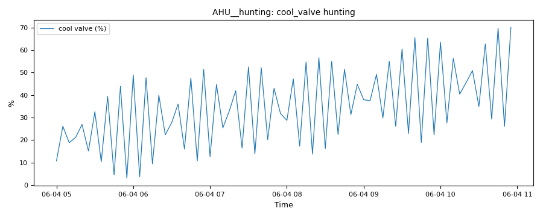

# Dirty filters and a hunting valve

*Workbook exercise `air-maintenance` · PNNL re-tuning chapters 5 and 9 · about 40 minutes*

## Goal

Find an air filter that is due for a change and a cooling valve whose control loop hunts. No
open dataset in the catalog shows either fault. Then find out how much each verdict depends on
the window the rule judges and on how often the trend is sampled.

## Learn more

Read these first (PNNL, free):

- [Chapter 5: Air Handling Units][pnnl-retuning-ch5] of the re-tuning training, for reading an
  air handler's trends before you change anything.
- [Chapter 9: Building Walk Down][pnnl-retuning-ch9], the reference `filter_fouling` cites: its
  air-handler walk-down lists dirty, plugged or collapsed filters among the things to inspect. A
  trend tells you which unit to open first.
- [Trending Requirements for Re-Tuning][pnnl-trending-requirements]: which points to trend, at
  what interval and for how long. Steps 6 and 7 show why the interval matters here.

[pnnl-retuning-ch5]: https://www.pnnl.gov/sites/default/files/media/file/ch5_air_handling.pdf "Large Commercial Buildings: Re-tuning for Efficiency, chapter 5: Air Handling Units: Pre-Re-Tuning and Trending and Re-Tuning (PNNL-SA-85063)"
[pnnl-retuning-ch9]: https://www.pnnl.gov/sites/default/files/media/file/ch9_building_walkdown.pdf "Large Commercial Buildings: Re-tuning for Efficiency, chapter 9: Building Walk Down (PNNL-SA-85063)"
[pnnl-trending-requirements]: https://www.pnnl.gov/sites/default/files/media/file/trending_requirements_retuning.pdf "Re-Tuning Training Guide: Trending Requirements for Re-Tuning"

## Datasets and licence

- **`synthetic-ahu-maintenance`**: a **synthetic** air handler that CAMBER generates on your
  computer. Nothing is downloaded and no real building is behind it. It holds the outdoor
  temperature, the supply fan's run status, the supply-air temperature, the cooling valve
  command and the differential pressure across the filter bank, every 5 minutes for two weeks of
  early summer. The unit runs every day from 05:00 to 21:00. Licence **Apache-2.0** (CAMBER's
  own; the data may be shared). About 0.9 MB. See
  [synthetic datasets](../DATASETS.md#synthetic-datasets) for how CAMBER generates it.

The same weather and the same schedule drive five units, each ingested as `AHU__<unit>` in the
facility `ds-synthetic-ahu-maintenance`: `AHU__healthy`, `AHU__loading`, `AHU__dirty`,
`AHU__hunting` and `AHU__near_miss`. Which is which is the exercise; the instructor key
describes how each was built.

## Setup

### In the lab

1. Run `camber lab` and open the URL it prints (`http://127.0.0.1:8765/lab?token=...`).
2. Tick `synthetic-ahu-maintenance` (its kind reads `synthetic`) and press **Fetch & ingest**.
   CAMBER generates the file instead of downloading it, then ingests it like any other dataset.
3. When the job is done, the row links to **trends** (the trend viewer) and to **report**, the
   audit report of the dataset's template at the trend's own 5-minute resolution. The lessons in
   steps 5 to 7 below use the command line.

### On the command line

```
camber datasets fetch synthetic-ahu-maintenance
camber datasets ingest synthetic-ahu-maintenance --store lab_store
camber datasets config synthetic-ahu-maintenance --exercise air-maintenance --store lab_store --out ahu.json
camber run ahu.json --out ahu_out
camber datasets score synthetic-ahu-maintenance --store lab_store --findings ahu_out/findings.json
```

The exercise's config (`--exercise air-maintenance`) runs two rules at their defaults on the
5-minute trend: `filter_fouling` (the filter's differential pressure) and `control_hunting` (the
cooling valve's reversals). Three variants run one rule each: `filter_fouling` on the second week
only, and `control_hunting` on the same data resampled to 10 and to 15 minutes:

```
camber datasets config synthetic-ahu-maintenance --exercise air-maintenance--lastweek --store lab_store --out ahu_week.json
camber run ahu_week.json --out ahu_week_out
camber datasets config synthetic-ahu-maintenance --exercise air-maintenance--10min --store lab_store --out ahu10.json
camber run ahu10.json --out ahu10_out
camber datasets config synthetic-ahu-maintenance --exercise air-maintenance--15min --store lab_store --out ahu15.json
camber run ahu15.json --out ahu15_out
```

## Steps

1. **Look before you judge.** In the trend viewer, plot each unit's filter differential pressure
   with the supply fan status over the whole fortnight. Then plot each unit's cooling valve and
   supply-air temperature over one morning, zoomed in until you can see single 5-minute samples.
2. **Run the exercise's config** (the commands above). For each unit, read `filter_fouling` in
   `ahu_out/findings.json`: the severity, `filter_dp_median_inwc`, `pct_over_threshold` and
   `filter_dp_p95_inwc`.
3. **The valves.** Read `control_hunting` for each unit: `reversals_per_hr`, `reversals` and
   `max_resolvable_per_hr`.
4. **Score.** Run `camber datasets score` and read the rates for the two rules.
5. **Judge the last week.** Run the `lastweek` variant and compare `AHU__loading` with step 2.
6. **Sample it every 10 minutes.** Run the `10min` variant. Compare each unit's severity and
   `reversals_per_hr` with step 3, and read the caveats.
7. **Sample it every 15 minutes.** Run the `15min` variant and read the severities, the rates
   and the caveats.

## Questions

1. Which filters does `filter_fouling` flag over the fortnight, and how badly? What do
   `pct_over_threshold` and `filter_dp_p95_inwc` say about the filter that passes but
   rose the most in your step 1 plot?
2. What share of the run is the fan off, what does a filter transmitter read then, and what does
   the rule do with those samples?
3. Judged on the last week only, what does `filter_fouling` say about `AHU__loading`? What
   should the site do, and when should the next check run?
4. Which valve does `control_hunting` flag, at what rate, and why not as a fault? What separates
   `AHU__near_miss` from it?
5. What does the label score say for the two rules over the fortnight, and on the last week for
   `filter_fouling`? Which miss is the rule's, and which is the window's?
6. Resampled to 10 minutes, what does `control_hunting` say, and what does
   `reversal_share_of_max` show about the hunting valve against the near miss?
7. Resampled to 15 minutes, what does the rule say, and why does it decline for a different
   reason than at 10 minutes?

## What CAMBER shows

- **Findings.** `camber run` prints one line per finding: one per rule and unit.
- **Filter.** `filter_fouling` reports `filter_dp_median_inwc` (the median differential
  pressure over the fan-on samples), `pct_over_threshold` (the share of those samples above the
  change-out pressure), `filter_dp_p95_inwc`, `change_dp_inwc` and `n_masked_fan_off` (the
  fan-off samples it set aside). It warns when the median reaches the change-out pressure (1.0
  in. w.c. by default) and faults at `fault_factor` (1.5) times it.
- **Hunting.** `control_hunting` reports `reversals_per_hr` (direction reversals beyond a 5 %
  deadband, per fan-on hour of the trend) on the worst of the unit's valves and dampers,
  `reversals` and `max_resolvable_per_hr`, the most reversals the trend's interval can show (one
  per sample). It warns at 6 an hour and faults at 12. When the interval cannot show the warn
  rate with a margin (its ceiling must be 1.25 times a threshold) it declines (`info`) with a
  caveat; when it cannot show the fault rate, a caveat says the severity is capped at warn.
- **Score.** `camber datasets score` prints the true- and false-positive rates for the entry's
  two declared detectors.



*From this exercise's synthetic unit `AHU__hunting`: the `control_hunting` evidence trend, the cooling valve command over six hours of one morning, from the 05:00 start. Each swing that reverses by more than 5 % of stroke counts.*

## Caveats

- The data are synthetic: CAMBER's own model of one air handler, built to show these faults.
  They show what the rules see, not how real units behave; never cite them as evidence about a
  building.
- Both rules judge only the samples with the fan running (status, else speed, else airflow); a
  unit with no fan signal is judged over every sample, with a caveat.
- `filter_fouling` does not correct for airflow. A filter's pressure drop rises with the air
  through it, so on a variable-volume unit a low fan speed reads as a cleaner filter. This unit is
  constant-volume.
- The 1.0 in. w.c. change-out pressure is a generic default. A real filter's final resistance
  comes from its maker's data or the site's own change-out practice.
- A 5-minute trend can show at most 12 reversals an hour, the fault rate itself. To call a loop
  hunting as a fault, trend it every minute.

## Going further

- Run `camber rules params filter_fouling` and `camber rules params control_hunting` to see
  where each default comes from and how to calibrate it.
- Read [the trend-quality exercise](data-trend-quality.md): which of its units' trends could
  show a hunting loop at all?
