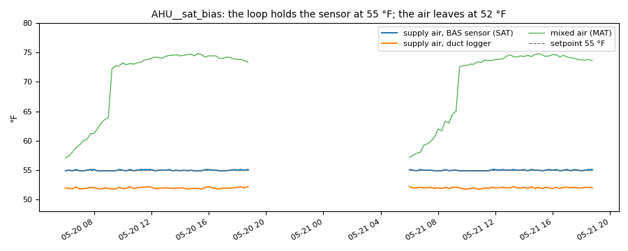

# A sensor that reads 3 °F high: conditional findings and money at risk

*Workbook exercise `data-sensor-conditional` · PNNL re-tuning chapters 4 and 5 · about 45 minutes*

## Goal

Two identical air handlers give two different sets of findings. Find out which differences come
from the equipment and which from one sensor that reads a few degrees high. Then see what CAMBER's
sensor checks can and cannot catch, what an independent reference adds, and how the RCx report
separates the money it is sure of from the money that depends on a sensor you do not trust.

## Learn more

Read these first (PNNL, free):

- [Chapter 4: Trend Data Collection and Analysis][pnnl-retuning-ch4] of the re-tuning training:
  why every trend gets a sanity check before it is used to judge a sequence.
- [Chapter 5: Air Handling Units][pnnl-retuning-ch5], for reading the supply, mixed and return
  air together.
- [AHU Discharge-Air Temperature Control][pnnl-guide-discharge-air-temp]: the supply-air
  temperature loop and its reset, and what a wrong reading does to them.

[pnnl-retuning-ch4]: https://www.pnnl.gov/sites/default/files/media/file/ch4_pre-re-tuning.pdf "Large Commercial Buildings: Re-tuning for Efficiency, chapter 4: Pre-Re-Tuning Phase: Trend Data Collection and Analysis (PNNL-SA-85063)"
[pnnl-retuning-ch5]: https://www.pnnl.gov/sites/default/files/media/file/ch5_air_handling.pdf "Large Commercial Buildings: Re-tuning for Efficiency, chapter 5: Air Handling Units: Pre-Re-Tuning and Trending and Re-Tuning (PNNL-SA-85063)"
[pnnl-guide-discharge-air-temp]: https://www.pnnl.gov/sites/default/files/media/file/pnnl_sa_84186.pdf "Building Re-Tuning Training Guide: AHU Discharge-Air Temperature Control (PNNL-SA-84186)"

## Datasets and licence

- **`synthetic-ahu-sensor-bias`**: two **synthetic** variable-air-volume air handlers that CAMBER
  generates on your computer. Nothing is downloaded and no real building is behind them. They
  trend the outdoor, return, mixed and supply air temperatures, the supply-air setpoint, the
  outdoor-air damper, the supply airflow, the heating and cooling valves, the fan status and the
  occupancy point, every 15 minutes for three weeks of late spring. Licence **Apache-2.0**
  (CAMBER's own; the data may be shared). About 0.3 MB. See
  [synthetic datasets](../DATASETS.md#synthetic-datasets) for how CAMBER generates it.

The facility `ds-synthetic-ahu-sensor-bias` holds `AHU__healthy` and `AHU__sat_bias`: the same
air handler with the same sequence, a fixed 55 °F supply-air setpoint. The site's design
sequence resets that setpoint from 55 °F up to 62 °F as the outdoor air falls from 70 °F to
60 °F; the BAS never does. For four weekdays in the second week a commissioning agent left a
calibrated logger in each unit's supply duct: `LOGGER__healthy` and `LOGGER__sat_bias` hold its
reading (`supply_air_temp`), and nothing outside those days.

## Setup

### In the lab

1. Run `camber lab` and open the URL it prints (`http://127.0.0.1:8765/lab?token=...`).
2. Tick `synthetic-ahu-sensor-bias` (its kind reads `synthetic`) and press **Fetch & ingest**.
   CAMBER generates the file instead of downloading it, then ingests it like any other dataset.
3. When the job is done, the row links to **trends** (the trend viewer) and to **report**. The
   steps below use the RCx layout on the command line.

### On the command line

First the run before anyone checks the sensors, then the same run with the duct loggers as
references:

```
camber datasets fetch synthetic-ahu-sensor-bias
camber datasets ingest synthetic-ahu-sensor-bias --store lab_store
camber datasets config synthetic-ahu-sensor-bias --exercise data-sensor-conditional--no-reference --store lab_store --out before.json
camber run before.json --out before_out
camber report before.json --layout rcx --out before_rcx.html
camber datasets config synthetic-ahu-sensor-bias --exercise data-sensor-conditional --store lab_store --out bias.json
camber report bias.json --layout rcx --out bias_rcx.html
```

Both configs run `supply_air_control` (the supply air against its setpoint),
`supply_air_reset_compliance` against the site's design reset (`t_max` 62, priced with the
reheat-coil capacities in `report.rcx.loads`) and `leaking_valve`; read their `_comment`. The
exercise's config adds one block under `report.rcx`, the references: each unit's supply-air
sensor against the logger in its duct.

```json
{
  "references": {
    "AHU__healthy": {"supply_air_temp": {"equip": "LOGGER__healthy", "label": "duct logger"}},
    "AHU__sat_bias": {"supply_air_temp": {"equip": "LOGGER__sat_bias", "label": "duct logger"}}
  }
}
```

## Steps

1. **Look before you judge.** In the trend viewer, plot each unit's supply air, mixed air and
   setpoint with its two valves over one morning in the first week. Then add the logger's reading
   for a day in the second week.
2. **Run the config without references.** For each unit, read the three rules in
   `before_out/findings.json`: `supply_air_control`'s `off_setpoint_pct`, `leaking_valve`'s
   `hw_leak_pct`, `median_delta_f` and `n_both_closed`, and `supply_air_reset_compliance`'s
   `pct_below_target` and `mean_gap_f`.
3. **Ask the sensor checks.** Open `before_rcx.html` and find the sensor-trust table in the data
   section. What does it say about each unit's `supply_air_temp`?
4. **Read the report.** Read the executive summary: each issue's rank, cost and confidence, the
   total, and anything at risk.
5. **Bring in the references.** Open `bias_rcx.html` and find the table of sensors against their
   references in the data section.
6. **Read the report again.** Compare its executive summary with step 4: the totals, each issue's
   confidence, and the new sensor issue.

## Questions

1. Which rules flag which unit? For each flag on `AHU__sat_bias`, is it the equipment or the
   reading?
2. Why does `supply_air_control` pass a unit whose supply air is 3 °F colder than its setpoint?
3. Why does `leaking_valve` call a heating-valve leak on `AHU__sat_bias`, and what would you check
   on site before replacing a valve?
4. What does the sensor-trust table say about the biased sensor, and why can no check of one trend
   catch this fault?
5. Before the references, what does the RCx report price, and what is at risk?
6. What do the logger comparisons show for each unit?
7. After the references, which findings are conditional, on what, and what moved from the firm total
   to the at-risk total? Why does the healthy unit's identical reset finding stay firm?
8. Is the at-risk reset estimate too high or too low, once the sensor is fixed?

## What CAMBER shows

- **Findings.** `supply_air_control` reports `off_setpoint_pct`, the share of occupied running
  samples more than 2 °F from the setpoint. `leaking_valve` reads the supply air against the
  mixed air with both valves shut: `hw_leak_pct` is the share more than 3 °F beyond its 2 °F
  fan-heat allowance, `median_delta_f` the median rise beyond it and `n_both_closed` the samples
  it judged. `supply_air_reset_compliance` reports `pct_below_target` and `mean_gap_f`
  against the configured reset map (`target_source` "configured"; the summary reads "vs
  configured target").
- **Sensor trust.** The RCx report's data section scores every point from its own trend:
  coverage, flatlines, outliers, range and the cross-sensor checks. A sensor that is
  `untrusted`, stuck, a copy of another point or failing the mixed-air checks makes the findings
  that read it **conditional**. See [Sensor health](../SENSOR-HEALTH.md).
- **A reference.** `report.rcx.references` compares a unit's point with a reference it should
  track (another equipment's reading in the store, or a CSV file), the same comparison as the OAT
  reference: `bias` (warn at 2 °F, fault at 5 °F), drift per month (evaluated over 28 days or
  more), RMSE and correlation, in a table in the data section. A warn or fault is a
  `sensor_drift:<role>` issue on that unit, and the unit's findings that read the point become
  conditional. See [Sensor references](../RCX-REPORT.md#sensor-references).
- **Conditional and at risk.** A conditional issue keeps its verdict and its estimate, at
  confidence L, and names the sensor it depends on. The report adds its dollars to "at risk
  pending a sensor fix", not to the firm total. See the [RCx report](../RCX-REPORT.md).



*From this exercise's synthetic unit `AHU__sat_bias`: two occupied days of its supply-air sensor, the duct logger in the same duct, the mixed air and the setpoint. The loop holds the sensor at 55 °F; the air leaves at 52 °F.*

## Caveats

- The data are synthetic: CAMBER's own model of two air handlers, built to show this fault.
  They show what the rules and the sensor checks see, not how real units behave; never cite them
  as evidence about a building.
- A reference is only as good as its own calibration and placement: a logger in a stratified
  duct, or a few inches from a coil, disagrees with a good sensor too.
- Four days measure a bias, not a drift: `drift_per_month` needs 28 days of overlap.
- The healthy unit's fixed setpoint is a real finding on both units. Only the biased unit's copy
  depends on a sensor you do not trust.

## Going further

- Run `camber rules params leaking_valve` and `camber rules params supply_air_reset_compliance` to
  see where each default comes from.
- Read [the trend-quality exercise](data-trend-quality.md): which sensor faults does the trust
  layer catch on its own?
