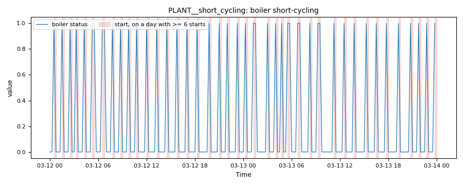

# Boiler short-cycling and low hot-water delta-T

*Workbook exercise `plant-boiler-cycling` · PNNL re-tuning chapter 8 · about 40 minutes*

## Goal

Find a boiler that short-cycles and a hot-water loop that moves too much water for the heat it
delivers. No open dataset in the catalog shows either fault. Then find out how much the
short-cycling verdict depends on how often the trend is sampled and on the starts-per-day limit
you choose.

## Learn more

Read these first (PNNL, free):

- [Central Utility Plant Heating Control][pnnl-guide-plant-heating], the re-tuning guide: its
  questions on boiler cycling, the hot-water loop's delta-T and resetting the pump's differential
  pressure are the three parts of this exercise.
- [Chapter 8: Central Utility Plant][pnnl-retuning-ch8] of the re-tuning training.

[pnnl-guide-plant-heating]: https://www.pnnl.gov/sites/default/files/media/file/pnnl_sa_89222.pdf "Building Re-Tuning Training Guide: Central Utility Plant Heating Control (PNNL-SA-89222)"
[pnnl-retuning-ch8]: https://www.pnnl.gov/sites/default/files/media/file/ch8_central_plant.pdf "Large Commercial Buildings: Re-tuning for Efficiency, chapter 8: Central Utility Plant: Pre-Re-Tuning and Re-Tuning (PNNL-SA-85063)"

## Datasets and licence

- **`synthetic-hw-plant-cycling`**: a **synthetic** hot-water plant that CAMBER generates on your
  computer. Nothing is downloaded and no real building is behind it. It holds the outdoor
  temperature, the boiler's firing, the loop supply and return temperatures, the pump speed, and
  the loop differential pressure with its setpoint, every 15 minutes for three weeks of early
  spring. Licence **Apache-2.0** (CAMBER's own; the data may be shared). About 0.5 MB. See
  [synthetic datasets](../DATASETS.md#synthetic-datasets) for how CAMBER generates it.

The same weather and the same building drive four plants, each ingested as `PLANT__<plant>` in
the facility `ds-synthetic-hw-plant-cycling`: `PLANT__well_tuned`, `PLANT__short_cycling`,
`PLANT__marginal` and `PLANT__low_delta_t`. Which is which is the exercise; the instructor key
describes how each was built.

## Setup

### In the lab

1. Run `camber lab` and open the URL it prints (`http://127.0.0.1:8765/lab?token=...`).
2. Tick `synthetic-hw-plant-cycling` (its kind reads `synthetic`) and press **Fetch & ingest**.
   CAMBER generates the file instead of downloading it, then ingests it like any other dataset.
3. When the job is done, the row links to **trends** (the trend viewer) and to **report**, the
   audit report of the dataset's template at the trend's own 15-minute resolution. The lessons in
   steps 5 and 6 below use the command line.

### On the command line

```
camber datasets fetch synthetic-hw-plant-cycling
camber datasets ingest synthetic-hw-plant-cycling --store lab_store
camber datasets config synthetic-hw-plant-cycling --exercise plant-boiler-cycling --store lab_store --out cyc.json
camber run cyc.json --out cyc_out
camber datasets score synthetic-hw-plant-cycling --store lab_store --findings cyc_out/findings.json
```

The exercise's config (`--exercise plant-boiler-cycling`) runs three rules at their defaults on
the 15-minute trend: `boiler_short_cycle` (firing starts per day), `hw_plant_deltat` (the loop
delta-T while the boiler fires) and `hw_pump_dp_reset` (the pump's speed and its DP setpoint).
Two variants run `boiler_short_cycle` only: one on the same data resampled to an hour, one with a
limit of 10 starts a day instead of 6:

```
camber datasets config synthetic-hw-plant-cycling --exercise plant-boiler-cycling--hourly --store lab_store --out cyc1h.json
camber run cyc1h.json --out cyc1h_out
camber datasets config synthetic-hw-plant-cycling --exercise plant-boiler-cycling--10starts --store lab_store --out cyc10.json
camber run cyc10.json --out cyc10_out
```

## Steps

1. **Look before you judge.** In the trend viewer, open each of the four plants and plot the
   boiler firing with the outdoor temperature over two or three days. Zoom in until you can see
   single 15-minute samples. Then plot the loop supply and return temperatures and the pump speed.
2. **Run the exercise's config** (the commands above). For each plant, read `boiler_short_cycle`
   in `cyc_out/findings.json`: the severity, `starts_per_day`, `runtime_pct` and `n_starts`.
3. **The loop and the pump.** Read `hw_plant_deltat` (`deltaT_median_f`, `low_deltaT_pct`) and
   `hw_pump_dp_reset` (`median_speed_pct`, `pct_running_near_full`, `dp_sp_reset_present`) for
   each plant.
4. **Score.** Run `camber datasets score` and read the rates for the three rules.
5. **Sample it hourly.** Run the `hourly` variant and compare each plant's severity,
   `starts_per_day` and `runtime_pct` with step 2, and read the findings' caveats.
6. **Choose the limit.** Run the `10starts` variant. Note which verdicts change and which stay.

## Questions

1. Which plants does `boiler_short_cycle` flag, and how badly? What does `runtime_pct` say about
   the short-cycling boiler?
2. Which plant fails the loop and pump checks, and what do its delta-T and pump speed say? Why
   does the short-cycling plant pass them?
3. What does the label score say for the three rules? Which plant is the false alarm, and is it
   one?
4. Resampled to an hour, what happens to the short-cycling boiler's `starts_per_day`,
   `runtime_pct` and severity? What does the caveat say, and why is the hourly count a floor?
5. With a limit of 10 starts a day, which verdict changes? Where should the limit come from on a
   real site?

## What CAMBER shows

- **Findings.** `camber run` prints one line per finding: one per rule and plant.
- **Starts.** `boiler_short_cycle` reports `starts_per_day` (the firing starts, off to on, divided
  by the days in the trend), `n_starts`, `runtime_pct` (the share of time firing) and
  `max_starts_per_day`. It warns at the limit and faults at twice it. On a trend coarser than
  `max_interval_min` (15 minutes) it also reports `interval_min` and `n_partial` (samples firing
  for part of their interval), caveats the count as a floor, and declines (`info`) rather than
  pass a boiler whose samples show part-interval firing.
- **Loop.** `hw_plant_deltat` reports `deltaT_median_f` and `low_deltaT_pct`, the share of occupied
  firing samples below the 20 °F design minimum. It warns at 20 % and faults at 50 %.
- **Pump.** `hw_pump_dp_reset` reports `median_speed_pct`, `pct_running_near_full` (speeds of 90 %
  or more) and `dp_sp_reset_present` (whether the DP setpoint moves). It faults at 60 % of running
  samples near full speed.
- **Score.** `camber datasets score` prints the true- and false-positive rates for the entry's
  three declared detectors.



*From this exercise's synthetic plant `PLANT__short_cycling`: the `boiler_short_cycle` evidence trend, the boiler's firing status (1 = firing) over two days. Each shaded interval is a start on a day with at least 6 of them.*

## Caveats

- The data are synthetic: CAMBER's own model of one plant, built to show these faults. They show
  what the rules see, not how real plants behave; never cite them as evidence about a building.
- A 15-minute trend still hides a firing shorter than 15 minutes, so a start count is a floor.
- `hw_plant_deltat` judges occupied firing samples only (weekdays 07:00 to 18:00 by default).
- The starts-per-day limit and the 20 °F design delta-T are generic defaults. A real boiler's
  minimum cycle time and a real loop's design delta-T come from its documentation.

## Going further

- Read [the boiler plant exercise](plant-boiler.md): its plant trends hourly. Which of this
  exercise's findings could you have seen there?
- Run `camber rules params boiler_short_cycle` and `camber rules params hw_plant_deltat` to see
  where each default comes from and how to calibrate it.
