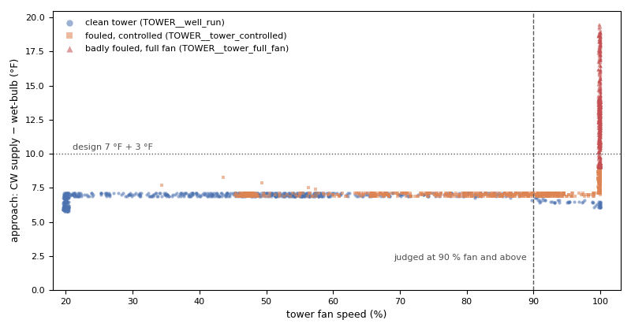

# Two chillers, a secondary loop and a fouled tower

*Workbook exercise `plant-chiller-multi` · PNNL re-tuning chapter 8 · about 50 minutes*

## Goal

Judge a plant with more than one of everything. Find two chillers running when one would do, a
secondary loop that runs warm while both chillers hold their setpoint, a chiller with a fouled
condenser, and two fouled cooling towers: one pinned at full fan, one whose controller hides the
fouling in its fan. Then look at a plant a little off everywhere that passes every check.

## Learn more

Read these first (PNNL, free):

- [Central Utility Plant Cooling Control][pnnl-guide-plant-cooling], the re-tuning guide: chiller
  staging, the primary-secondary loop and the cooling tower are all in its questions.
- [Chapter 8: Central Utility Plant][pnnl-retuning-ch8] of the re-tuning training.

[pnnl-guide-plant-cooling]: https://www.pnnl.gov/sites/default/files/media/file/pnnl_sa_89198.pdf "Building Re-Tuning Training Guide: Central Utility Plant Cooling Control (PNNL-SA-89198)"
[pnnl-retuning-ch8]: https://www.pnnl.gov/sites/default/files/media/file/ch8_central_plant.pdf "Large Commercial Buildings: Re-tuning for Efficiency, chapter 8: Central Utility Plant: Pre-Re-Tuning and Re-Tuning (PNNL-SA-85063)"

## Datasets and licence

- **`synthetic-chw-plant-multi`**: a **synthetic** primary-secondary chilled-water plant that
  CAMBER generates on your computer: two equal chillers on constant primary flow, a decoupler, a
  variable-flow secondary loop and one cooling tower. Nothing is downloaded and no real building
  is behind it. It holds the outdoor dry-bulb and wet-bulb; each chiller's run status, power,
  leaving and entering water, and the condenser and evaporator approaches its controller reports;
  the secondary loop's supply, return, setpoint, flow, pump speed and pump power; and the tower's
  leaving and return water and fan speed. The data are every 15 minutes for three summer weeks,
  with a heat wave in the third. Licence **Apache-2.0** (CAMBER's own; the data may be shared).
  About 1.7 MB. See [synthetic datasets](../DATASETS.md#synthetic-datasets) for how CAMBER
  generates it.

The same weather and the same building drive seven plants: `well_run`, `over_staged`,
`reverse_mixing`, `fouled_condenser`, `tower_full_fan`, `tower_controlled` and `near_miss`. Each
plant is four pieces of equipment in the facility `ds-synthetic-chw-plant-multi`: `CH1__<plant>`
and `CH2__<plant>` (the chillers), `SECLOOP__<plant>` (the secondary loop) and `TOWER__<plant>`.
The plant names say where to look; what is wrong, and which rule sees it, is the exercise.

## Setup

### In the lab

1. Run `camber lab` and open the URL it prints (`http://127.0.0.1:8765/lab?token=...`).
2. Tick `synthetic-chw-plant-multi` (its kind reads `synthetic`) and press **Fetch & ingest**.
   CAMBER generates the file instead of downloading it, then ingests it like any other dataset.
3. When the job is done, the row links to **trends** (the trend viewer) and to **report**, the
   audit report of the dataset's template at the trend's own 15-minute resolution. The fleet
   steps below use the command line.

### On the command line

```
camber datasets fetch synthetic-chw-plant-multi
camber datasets ingest synthetic-chw-plant-multi --store lab_store
camber datasets config synthetic-chw-plant-multi --exercise plant-chiller-multi --store lab_store --out multi.json
camber run multi.json --out multi_out
camber datasets score synthetic-chw-plant-multi --store lab_store --findings multi_out/findings.json
```

The exercise's config (`--exercise plant-chiller-multi`) runs four rules at their defaults on the
15-minute trend: `chiller_staging_fleet` (over the whole facility, on purpose),
`chw_supply_tracking`, `chiller_approach_fouling` and `cooling_tower_approach`. Its `drift`
section adds the tower drift family with a **declared reference**:
`cooling_tower_fan_effort_drift` scores each tower's fan effort against `TOWER__well_run`,
fitted in memory on each run and never stored.

Three variants run `chiller_staging_fleet` on one plant's two chillers only:
`plant-chiller-multi--well-run`, `plant-chiller-multi--over-staged` and
`plant-chiller-multi--near-miss`. For the over-staged plant:

```
camber datasets config synthetic-chw-plant-multi --exercise plant-chiller-multi--over-staged --store lab_store --out fleet_over.json
camber run fleet_over.json --out fleet_over_out
```

## Steps

1. **Look before you judge.** In the trend viewer, open `CH1__well_run` and `CH2__well_run` and
   plot both chillers' power over a week. When does the second chiller start? Do the same for the
   over-staged plant. Then plot `SECLOOP__reverse_mixing`'s supply temperature with its setpoint,
   and `CH1__reverse_mixing`'s leaving water.
2. **Run the exercise's config** (the commands above) and read the `chiller_staging_fleet` line
   `camber run` prints. How many chillers does it count, and where does its finding sit?
3. **One plant at a time.** Run the three fleet variants and read `pct_overstaged`,
   `n_multi_hours`, `median_running_count` and `rep_capacity_kw` in each `findings.json`.
4. **The secondary loop.** Read `chw_supply_tracking` for every `SECLOOP__<plant>` and for the
   reverse-mixing plant's two chillers: `above_pct`, `median_excess_above_f`, `chwst_median_f`,
   `deltaT_median_f` and `run_source`.
5. **The condensers.** Read `chiller_approach_fouling` for each chiller: `cond_approach_f`,
   `evap_approach_f` and `worst_approach_ratio`.
6. **The towers.** Read `cooling_tower_approach` for `TOWER__well_run`, `TOWER__tower_full_fan`
   and `TOWER__tower_controlled`: `approach_median_f`, `pct_hours_high_approach`, `n_operating`
   and `n_low_effort_excluded`. Then read `cooling_tower_fan_effort_drift` for every tower:
   `fan_effort_drift_pct` and the summary.
7. **Score.** Run `camber datasets score` and read the overall rates and each rule's.

## Questions

1. Over the whole facility, how many chillers does `chiller_staging_fleet` count, and what does
   it conclude? Why is that number wrong, and what fixes it?
2. On one plant at a time, which plant over-stages? What capacity does the rule assume for a
   chiller, where does that figure come from, and why does it read low on that plant?
3. Which plant's secondary loop misses its setpoint? Are its chillers at fault? What is the loop
   delta-T, and what is the water in the decoupler doing?
4. Which chiller's condenser is fouled, and how far is its approach from design?
5. Which tower does `cooling_tower_approach` flag, and which does it pass? Both are fouled: what
   does the controlled tower do instead of widening its approach, and which rule sees that?
6. `cooling_tower_fan_effort_drift` also warns on a tower that is not fouled. Which one, and why
   might the over-staged plant's tower look harder-working?
7. What does the label score say for each rule, and for the plant as a whole? Which fault can no
   label score count, and why?
8. The near-miss plant passes every check. What is a little off in it, and what would you watch?

## What CAMBER shows

- **Findings.** `camber run` prints one line per finding: one per rule and equipment, plus one
  `<fleet>` line for `chiller_staging_fleet`.
- **Fleet.** `chiller_staging_fleet` takes every equipment that carries a chiller's power and
  puts them on one clock. A sample is over-staged when two or more run and their total power
  would fit in one machine fewer at 90 % (`redundancy_ceiling`) of a chiller's capacity. That
  capacity (`rep_capacity_kw`) is the median, across the chillers, of each one's own 95th
  percentile running power. It warns when 20 % of the multi-chiller samples are over-staged and
  faults at 50 %. Its finding sits on `<fleet>`, not on a chiller.
- **Supply tracking.** `chw_supply_tracking` reports the share of running time with the supply
  more than 3 °F above its setpoint (`above_pct`): a warn at 10 %, a fault at 25 %. "Running" is
  the chiller's status when mapped, else its power (`run_source`). The secondary loop has no
  chiller status, so the rule reads its power point, the pumps' here, and its caveat calls that
  the chiller's power.
- **Approach.** `chiller_approach_fouling` compares each chiller's median condenser and
  evaporator approach with 5 and 4 °F (`worst_approach_ratio`): a warn at 1.5 times design, a
  fault at 2.
- **Tower.** `cooling_tower_approach` judges the approach (leaving water minus wet-bulb) only in
  samples with the fan at 90 % or more (`n_operating`; the rest are `n_low_effort_excluded`),
  against a 7 °F design: a warn when the median is 1.3 times design, a fault at 1.7.
  `cooling_tower_fan_effort_drift` reads the fan speed against the reference tower at matched
  condenser range and wet-bulb: a warn at 5 percentage points, a fault at 10.
- **Score.** `camber datasets score` prints the true- and false-positive rates, with 95 %
  intervals, for the entry's declared detectors and for the plant as a whole.



*From this exercise's synthetic plants: each tower's approach (condenser water leaving minus wet-bulb) against its fan speed, every running sample. `cooling_tower_approach` judges only the samples right of the dashed 90 % line, and counts those above the dotted line (design 7 °F plus 3 °F) as high.*

## Caveats

- The data are synthetic: CAMBER's own model of one plant, built to show these faults. They show
  what the rules see, not how real plants behave; never cite them as evidence about a building.
- The approaches are the chiller controller's own refrigerant-side readings, generated directly.
  A real chiller reports them from its refrigerant pressures and temperatures, and not every
  controller trends them.
- In the heat wave, the badly fouled tower sends condenser water near 99 °F. A real chiller would
  trip on high head pressure before that.
- A 15-minute trend averages a chiller's start into its first sample, and the fleet rule's counts
  are of 15-minute samples, not hours.

## Going further

- Compare with [the cooling tower exercise](plant-cooling-tower.md): its simulated tower is
  controlled to the wet-bulb plus 8 °F, so its fouling shows only as fan effort, and
  `cooling_tower_approach` scores no fouled run there.
- Edit `fleet_over.json` and set `chiller_staging_fleet`'s `redundancy_ceiling` lower and higher.
  How does the over-staged share move, and what would you set it from on a real plant?
- Run `camber rules params chw_supply_tracking` and `camber rules params cooling_tower_approach`
  to see where each default comes from.
