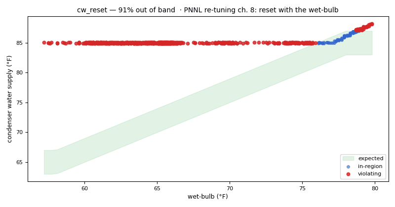

# Chiller staging and condenser-water reset

*Workbook exercise `plant-chiller-staging` · PNNL re-tuning chapter 8 · about 40 minutes*

## Goal

Find a chiller that short-cycles, a chiller left running through the night, and a cooling tower
held at a fixed setpoint instead of reset with the weather. No open dataset in the catalog shows
these faults. Then look at a reset that passes the check but saves little, and decide how strict
the check should be.

## Learn more

Read these first (PNNL, free):

- [Central Utility Plant Cooling Control][pnnl-guide-plant-cooling], the re-tuning guide: its
  questions on chiller staging and on resetting the condenser water with the outdoor wet-bulb are
  the two halves of this exercise.
- [Chapter 8: Central Utility Plant][pnnl-retuning-ch8] of the re-tuning training.

[pnnl-guide-plant-cooling]: https://www.pnnl.gov/sites/default/files/media/file/pnnl_sa_89198.pdf "Building Re-Tuning Training Guide: Central Utility Plant Cooling Control (PNNL-SA-89198)"
[pnnl-retuning-ch8]: https://www.pnnl.gov/sites/default/files/media/file/ch8_central_plant.pdf "Large Commercial Buildings: Re-tuning for Efficiency, chapter 8: Central Utility Plant: Pre-Re-Tuning and Re-Tuning (PNNL-SA-85063)"

## Datasets and licence

- **`synthetic-chw-plant-staging`**: a **synthetic** chilled-water plant, one chiller and its
  cooling tower, that CAMBER generates on your computer. Nothing is downloaded and no real
  building is behind it. It holds the outdoor dry-bulb and wet-bulb, the chiller's power, the
  chilled-water supply, return and flow, the condenser water leaving and returning to the tower,
  and the tower fan speed, every 15 minutes for three summer weeks with a heat wave in the third.
  Licence **Apache-2.0** (CAMBER's own; the data may be shared). About 0.7 MB. See
  [synthetic datasets](../DATASETS.md#synthetic-datasets) for how CAMBER generates it.

The same weather and the same building drive five plants, each ingested as `PLANT__<plant>` in
the facility `ds-synthetic-chw-plant-staging`: `PLANT__well_staged`, `PLANT__short_cycling`,
`PLANT__left_on`, `PLANT__fixed_cw` and `PLANT__high_floor`. Which is which is the exercise; the
instructor key describes how each was built.

## Setup

### In the lab

1. Run `camber lab` and open the URL it prints (`http://127.0.0.1:8765/lab?token=...`).
2. Tick `synthetic-chw-plant-staging` (its kind reads `synthetic`) and press **Fetch & ingest**.
   CAMBER generates the file instead of downloading it, then ingests it like any other dataset.
3. When the job is done, the row links to **trends** (the trend viewer) and to **report**, the
   audit report of the dataset's template at the trend's own 15-minute resolution. The threshold
   lesson in step 5 below uses the command line.

### On the command line

```
camber datasets fetch synthetic-chw-plant-staging
camber datasets ingest synthetic-chw-plant-staging --store lab_store
camber datasets config synthetic-chw-plant-staging --exercise plant-chiller-staging --store lab_store --out stg.json
camber run stg.json --out stg_out
camber datasets score synthetic-chw-plant-staging --store lab_store --findings stg_out/findings.json
```

The exercise's config (`--exercise plant-chiller-staging`) runs two rules at their defaults on
the 15-minute trend: `chiller_staging` (starts per day, and how much of its running time the
chiller spends at a small part load) and `condenser_water_reset` (whether the tower's leaving
water follows the wet-bulb). A variant asks `condenser_water_reset` for a steeper reset:

```
camber datasets config synthetic-chw-plant-staging --exercise plant-chiller-staging--slope05 --store lab_store --out stg05.json
camber run stg05.json --out stg05_out
```

## Steps

1. **Look before you judge.** In the trend viewer, open each of the five plants and plot the
   chiller power over a week, then the condenser water supply with the wet-bulb over the three
   weeks. Find the heat wave.
2. **Run the exercise's config** (the commands above). For each plant, read `chiller_staging` in
   `stg_out/findings.json`: the severity, `starts_per_day`, `runtime_pct`,
   `load_factor_median_pct`, `low_load_pct`, `load_spread_pct` and any caveat.
3. **The condenser water.** Read `condenser_water_reset` for each plant: `cws_slope_per_wetbulb`,
   `cws_median_f`, `cws_above_wb_plus_approach_median_f` and `reset_present`.
4. **Score.** Run `camber datasets score` and read the rates for the two rules.
5. **Ask for more.** Run the `slope05` variant and note which verdicts change.

## Questions

1. Which plants fail `chiller_staging`? Do they fail it for the same reason?
2. Which plant fails `condenser_water_reset`, and what does its slope say?
3. One plant passes `condenser_water_reset` with a slope just above the line. What is its tower
   doing, and what does its median condenser water say that the verdict does not?
4. What does the label score say for the two rules?
5. With a required slope of 0.5, which verdicts change? Is that the right line for this plant, and
   how would you choose it on a real site?

## What CAMBER shows

- **Findings.** `camber run` prints one line per finding: one per rule and plant.
- **Staging.** `chiller_staging` reports `starts_per_day` (the chiller's starts, from its power,
  divided by the days in the trend), `runtime_pct`, `load_factor_median_pct` (the median load
  while running, as a share of the chiller's own observed peak) and `low_load_pct` (the share of
  running samples below 40 % of that peak). It warns at 6 starts a day or 25 % of running time at
  low load, and faults at 12 starts or 50 %. `load_spread_pct` is the spread of the running load
  (its 10th to 90th percentile) as a share of that peak. When it is 5 % or less, every run is at
  about the same output, and the finding carries a caveat: the load factor is then measured
  against that one output, so it says nothing about part load.
- **Condenser water.** `condenser_water_reset` regresses the tower's leaving water on the
  measured wet-bulb over the samples the tower fan runs and reports the slope
  (`cws_slope_per_wetbulb`), the median (`cws_median_f`) and `reset_present`. A slope under
  `reset_slope_flat` (0.3 °F per °F by default) is a flat setpoint: a `warn`, an opportunity
  rather than a broken part. `cws_above_wb_plus_approach_median_f` is for information only: the
  median of how far the condenser water sits above the wet-bulb plus the tower's design approach
  (`design_approach_f`, 7 °F by default, as in `cooling_tower_approach`). Near 0 the tower makes
  the coldest water its approach allows; well above it, a fixed setpoint or a reset's floor holds
  the water warmer. It never changes the verdict.
- **Score.** `camber datasets score` prints the true- and false-positive rates for the entry's two
  declared detectors.



*From this exercise's synthetic plant `PLANT__fixed_cw`: the condenser water leaving the tower against the wet-bulb, with the band a reset to the wet-bulb plus 5 to 9 °F would keep it in (between 65 and 85 °F). Red points are outside the band.*

## Caveats

- The data are synthetic: CAMBER's own model of one plant, built to show these faults. They show
  what the rules see, not how real plants behave; never cite them as evidence about a building.
- A 15-minute trend still hides a run shorter than 15 minutes, so a start count is a floor.
- `chiller_staging` judges one chiller. Whether a plant runs more chillers than its load needs is
  a question for `chiller_staging_fleet`, which this single-chiller plant cannot answer.
- The lowest condenser water a chiller accepts is the chiller maker's figure. A reset floor above
  it wastes energy; one below it can trip the chiller.

## Going further

- Read [the cooling tower exercise](plant-cooling-tower.md): its tower holds its leaving water at
  the wet-bulb plus 8 °F. Run `condenser_water_reset` there and compare.
- Run `camber rules params chiller_staging` and `camber rules params condenser_water_reset` to see
  where each default comes from and how to calibrate it.
