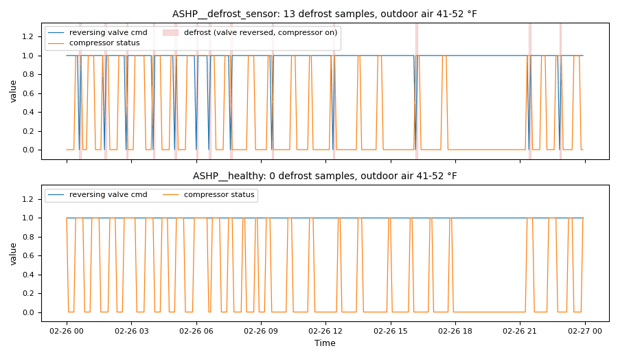

# Heat pumps: defrost, wrong mode, capacity, staging and the source loop

*Workbook exercise `plant-heat-pump` · heat-pump guides (no PNNL re-tuning chapter covers heat pumps) · about 50 minutes*

## Goal

Find the heat-pump faults that no open dataset in the catalog shows: a unit that defrosts far
too often, a unit that heats a room that is already too warm, a unit that falls behind in a cold
snap, a compressor stage that hunts, two units that fight in one room, and a source loop that
pumps water without carrying heat. Then find out what a 15-minute trend hides, and how much the
defrost verdict depends on the limit you choose.

## Learn more

No PNNL re-tuning guide or chapter covers heat pumps. Read these instead (free):

- [Heating and cooling with a heat pump][nrcan-heat-pump-guide] (Natural Resources Canada): its
  sections on the defrost cycle, on supplementary heat and the balance point, and on thermostats
  explain the defrost, capacity and mode parts of this exercise.
- [Guide to Installing Air-Source Heat Pumps in Cold Climates][neep-ashp-install-guide] (NEEP):
  its thermostat section says where a unit's thermostat belongs, which is what goes wrong in the
  room with two units.
- [Variable Flow Pumping][epri-tb-114673] (EPRI technical brief TB-114673): why a water-source
  loop whose pumps run at constant speed moves water it does not need.
- [Chapter 3 of the small-building re-tuning course][pnnl-small-retuning-ch3] (PNNL): its
  packaged-unit and thermostat sections cover the settings that make a compressor cycle or stage.

[nrcan-heat-pump-guide]: https://natural-resources.canada.ca/energy-efficiency/energy-star/heating-cooling-heat-pump "Heating and cooling with a heat pump"
[neep-ashp-install-guide]: https://neep.org/sites/default/files/Installing%20Air-Source%20Heat%20Pumps%20in%20Cold%20Climates.pdf "Guide to Installing Air-Source Heat Pumps in Cold Climates"
[epri-tb-114673]: https://restservice.epri.com/publicdownload/TB-114673/0/Product "Variable Flow Pumping: The Key to Energy Efficiency in Water Loop and Geothermal Heat Pump System Applications (TB-114673)"
[pnnl-small-retuning-ch3]: https://www.pnnl.gov/sites/default/files/media/file/ch3_sm_identifying_and_implementing_retuning_measures.pdf "Small/Medium-Sized Commercial Building Re-tuning Training, chapter 3: Identifying and Implementing Re-tuning Measures (PNNL-SA-92685)"

## Datasets and licence

- **`synthetic-heat-pump`**: the **synthetic** heat pumps of one small building, which CAMBER
  generates on your computer. Nothing is downloaded and no real building is behind it. It covers
  a fortnight of late winter, every 5 minutes: damp days around freezing, a three-day cold snap,
  two days of mild fog and a sunny spell, so the units both heat and cool. Licence
  **Apache-2.0** (CAMBER's own; the data may be shared). About 3 MB. See
  [synthetic datasets](../DATASETS.md#synthetic-datasets) for how CAMBER generates it.

Twelve pieces of equipment are ingested into the facility `ds-synthetic-heat-pump`:

- four **air-source** units (class `ASHP`), each trended with its zone and discharge-air
  temperatures, fan, occupancy, heating and cooling setpoints, compressor status and reversing
  valve (1 = heating): `ASHP__healthy`, `ASHP__defrost_sensor`, `ASHP__defrost_timer` and
  `ASHP__no_aux_heat`;
- six **water-source** units (class `WSHP`), trended with the same points but the compressor
  stage (0, 1 or 2) instead of the compressor and valve: `WSHP__classroom` and
  `WSHP__classroom_twin` share one room, `WSHP__window_side` and `WSHP__door_side` share another,
  and `WSHP__stuck_heating` and `WSHP__stage_hunting` each serve a room of their own;
- the water-source units' **source loop** (class `HPLOOP`), trended with its supply and return
  water, pump status, pump speed and differential pressure: `LOOP__loop_ok` and
  `LOOP__loop_flat`.

What is wrong with each is the exercise; the instructor key describes how each was built.

## Setup

### In the lab

1. Run `camber lab` and open the URL it prints (`http://127.0.0.1:8765/lab?token=...`).
2. Tick `synthetic-heat-pump` (its kind reads `synthetic`) and press **Fetch & ingest**. CAMBER
   generates the file instead of downloading it, then ingests it like any other dataset.
3. When the job is done, the row links to **trends** (the trend viewer) and to **report**, the
   audit report of the dataset's template at the trend's own 5-minute resolution. The lessons in
   steps 7 and 8 below use the command line.

### On the command line

```
camber datasets fetch synthetic-heat-pump
camber datasets ingest synthetic-heat-pump --store lab_store
camber datasets config synthetic-heat-pump --exercise plant-heat-pump --store lab_store --out hp.json
camber run hp.json --out hp_out
camber datasets score synthetic-heat-pump --store lab_store --findings hp_out/findings.json
```

The exercise's config (`--exercise plant-heat-pump`) runs six rules at their defaults on the
5-minute trend: `heatpump_defrost` (reversing-valve changes per day), `hp_mode_vs_need` (heating
a warm room or cooling a cold one), `hp_capacity_shortfall` (a room out of its band while its
unit works), `hp_room_imbalance` (units in one room that fight), `compressor_staging` (stage
changes per day) and `source_loop_deltat` (the loop's delta-T while it pumps). The units that
share a room are declared in the config's `topology` (each unit's parent is its room), since
nothing in a trend says which units share a room. Two variants run fewer rules: one on the same
data resampled to 15 minutes, one with a limit of 20 reversals a day instead of 24:

```
camber datasets config synthetic-heat-pump --exercise plant-heat-pump--15min --store lab_store --out hp15.json
camber run hp15.json --out hp15_out
camber datasets config synthetic-heat-pump --exercise plant-heat-pump--20rev --store lab_store --out hp20.json
camber run hp20.json --out hp20_out
```

## Steps

1. **Look before you judge.** In the trend viewer, open `ASHP__healthy` and
   `ASHP__defrost_sensor` and plot the reversing valve and the compressor over one foggy day
   (26 February) and one day of the cold snap (20 February). Zoom in until you can see single
   5-minute samples. Note the outdoor temperature when each unit defrosts.
2. **Run the exercise's config** (the commands above). For the four air-source units, read
   `heatpump_defrost` in `hp_out/findings.json`: the severity, `reversals_per_day` and
   `n_reversals`.
3. **Mode and capacity.** For every unit, read `hp_mode_vs_need` (`heating_while_warm_hours`,
   `cooling_while_cold_hours`, `wrong_mode_pct_of_running`, `mode_source`) and
   `hp_capacity_shortfall` (`heating_outside_pct`, `cooling_outside_pct`, `verdict`, `side`).
   Plot the zone and discharge-air temperatures of each unit that fires.
4. **The rooms.** Read the `hp_room_imbalance` finding (its equipment is `fleet`): `rooms` has
   one entry per room, with `fight_pct`, `active_pct`, `zone_sensor_spread_f` and a severity.
   Plot the zone temperatures of `WSHP__window_side` and `WSHP__door_side` together.
5. **Stages and the loop.** Read `compressor_staging` (`stage_changes_per_day`) for the six
   water-source units and `source_loop_deltat` (`deltat_median_f`, `deltat_p90_f`, `flat_pct`,
   `diff_press_median`) for the two loops.
6. **Score.** Run `camber datasets score` and read the rates for the five scored rules, then the
   per-equipment lines.
7. **Sample it every 15 minutes.** Run the `15min` variant and compare `reversals_per_day` and
   `stage_changes_per_day` with steps 2 and 5.
8. **Choose the limit.** Run the `20rev` variant. Note which defrost verdicts change.

## Questions

1. Which air-source unit does `heatpump_defrost` flag, and how badly? At what outdoor
   temperatures does it defrost, and why is that impossible for a coil carrying frost?
2. `ASHP__defrost_timer` passes, just under the limit. What makes it defrost more than the healthy
   unit, especially in the dry cold snap? With a limit of 20, what changes, and is it a fault?
3. Which unit heats a room that is already too warm? How does CAMBER know the unit is heating
   when no compressor or valve is trended? Why does `ASHP__no_aux_heat` also warn on
   `hp_mode_vs_need`?
4. Which unit falls out of its heating band while it runs flat out? What does the verdict say,
   and what does it say for `WSHP__stuck_heating`?
5. Which room's units fight, and for what share of the occupied time? Why do
   `hp_mode_vs_need` and `hp_capacity_shortfall` not see the fight, and what do they report
   instead?
6. Which unit's stages hunt? What do the stage changes per day of the other water-source units
   say about normal staging?
7. Which loop carries almost no heat, and what do its delta-T and DP say?
8. What does the label score say for each rule? Which unit is the false alarm for each rule that
   has one?
9. Resampled to 15 minutes, what happens to the defrost and stage counts? Why does a 15-minute
   trend hide a 5-minute defrost?

## What CAMBER shows

- **Findings.** `camber run` prints one line per finding: one per rule and unit, and one
  `fleet` finding for `hp_room_imbalance`.
- **Defrost.** `heatpump_defrost` counts every change of the reversing valve (into a defrost
  and out of it, and every heating/cooling changeover) and reports `reversals_per_day`,
  `n_reversals` and `max_reversals_per_day`. It warns at the limit (24) and faults at twice it.
- **Mode.** `hp_mode_vs_need` reports `heating_while_warm_hours`, `cooling_while_cold_hours` and
  `wrong_mode_pct_of_running`, in occupied hours. `mode_source` says how it knew the mode:
  `status` (the compressor and the reversing valve) or `discharge_vs_zone` (discharge air at least
  15 °F above the zone reads as heating, at least 10 °F below as cooling). It warns at 2 hours and
  2 % of the running time, and faults at 10 hours and 10 %.
- **Capacity.** `hp_capacity_shortfall` reports, per side, the share of occupied time out of band
  (`heating_outside_pct`, `cooling_outside_pct`) and the share of that time the unit was working
  in the right mode (`heating_working_pct`, `cooling_working_pct`). Its `verdict` is `capacity`
  (working at least 70 % of that time), `control` (at most 30 %) or `mixed`. It warns at 10 % of
  occupied time and faults at 25 %.
- **Rooms.** `hp_room_imbalance` reports per room `fight_pct` (one unit heating while another
  cools), the units' `active_pct` and its spread, and `zone_sensor_spread_f`. A room faults at a
  10 % fight and warns at 2 %, a 40-point active spread or a 3 °F sensor spread.
- **Stages.** `compressor_staging` reports `stage_changes_per_day` (every change of the stage,
  including on and off) and `max_stage`. It warns at 24 changes a day and faults at 48.
- **Loop.** `source_loop_deltat` reports the loop's |delta-T| while it pumps: `deltat_median_f`,
  `deltat_p90_f` and `flat_pct` (the share under 1 °F), against a 10 °F design value. It faults
  when 80 % of the pumping time is flat and the 90th percentile is under a quarter of the design.
- **Score.** `camber datasets score` prints the true- and false-positive rates for the entry's
  five scored rules. `hp_room_imbalance` is a fleet rule with no per-unit finding, so it is not
  scored: read its `rooms` instead.



*From this exercise's synthetic units `ASHP__defrost_sensor` (top) and `ASHP__healthy` (bottom) on 26 February: the reversing valve (1 = heating) and the compressor. Each shaded sample is a defrost: the valve reversed with the compressor running.*

## Caveats

- The data are synthetic: CAMBER's own model of one building and its heat pumps, built to show
  these faults. They show what the rules see, not how real heat pumps behave; never cite them as
  evidence about a building.
- A 5-minute trend still hides a defrost or a stage change shorter than 5 minutes, so the counts
  are a floor.
- The rules judge occupied hours (the trended `occupancy`, weekdays 07:00 to 18:00 here).
- Which units share a room comes from the config's `topology`, not from the data. On a real site
  it comes from the drawings or a walk-down.
- The limits are generic screening defaults (`camber rules params heatpump_defrost`). A real
  unit's defrost interval and staging delays come from its documentation and controls.

## Going further

- Read [the boiler cycling exercise](plant-boiler-cycling.md): its resolution lesson is the same
  one, for a boiler on a 15-minute trend.
- Run `camber rules params heatpump_defrost`, `camber rules params compressor_staging` and
  `camber rules params source_loop_deltat` to see where each default comes from and how to
  calibrate it.
