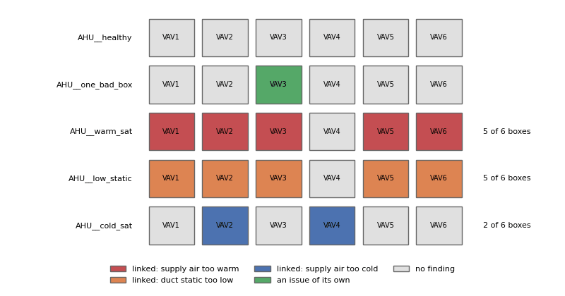

# RCx cause chains: one air handler, many boxes

*Workbook exercise `rcx-cause-chains` · PNNL re-tuning chapters 5 and 7 · about 40 minutes*

## Goal

An air handler that cannot cool its supply air, or cannot make its duct static, shows up first
at the boxes it serves: zones that run warm, boxes short of air. A retro-commissioning report that
lists every box finding as its own issue buries the one fix that clears them all, and adds up
the same waste several times. Read the RCx report's cause chains: which air handler explains
which boxes, which box problem is the box's own, and what the report does without a served-by
topology.

## Learn more

Read these first (PNNL, free):

- [Chapter 5: Air Handling Units][pnnl-retuning-ch5] of the re-tuning training: the supply-air
  temperature and duct static an air handler has to hold, and what to trend to see it do so.
- [Chapter 7: Terminal Units in Air Distribution System][pnnl-retuning-ch7]: what a VAV box can
  and cannot do when its air handler falls short.

[pnnl-retuning-ch5]: https://www.pnnl.gov/sites/default/files/media/file/ch5_air_handling.pdf "Large Commercial Buildings: Re-tuning for Efficiency, chapter 5: Air Handling Units: Pre-Re-Tuning and Trending and Re-Tuning (PNNL-SA-85063)"
[pnnl-retuning-ch7]: https://www.pnnl.gov/sites/default/files/media/file/ch7_terminal_units.pdf "Large Commercial Buildings: Re-tuning for Efficiency, chapter 7: Terminal Units in Air Distribution System: Pre-Re-Tuning and Re-Tuning (PNNL-SA-85063)"

## Datasets and licence

- **`synthetic-g36-rcx-chains`**: a **synthetic** VAV system that CAMBER generates on your
  computer, the same model as the [G36 fleet exercise](zone-g36-fleet.md). Nothing is downloaded
  and no real building is behind it. Each air handler trends its supply-air temperature, duct
  static pressure, their setpoints and reset requests, its supply fan's speed and its cooling
  valve. Each of its six single-duct reheat boxes trends its space temperature and setpoints,
  airflow and airflow setpoints, damper, reheat valve and loops. The data is hourly, for three
  weeks of spring. Licence **Apache-2.0** (CAMBER's own; the data may be shared). About 0.8 MB.
  See [synthetic datasets](../DATASETS.md#synthetic-datasets) for how CAMBER generates it.

Five air handlers are ingested with their boxes in the facility `ds-synthetic-g36-rcx-chains`:
`AHU__<name>` and `VAV1__<name>` to `VAV6__<name>`, where the name is one of `healthy`,
`one_bad_box`, `warm_sat`, `low_static` and `cold_sat`. Boxes 1 to 4 face east, west, south and
north; boxes 5 and 6 are interior. The run template declares which boxes each air handler serves
and how big each unit's reheat coil is, so the report can cost reheat.

## Setup

### In the lab

1. Run `camber lab` and open the URL it prints (`http://127.0.0.1:8765/lab?token=...`).
2. Tick `synthetic-g36-rcx-chains` (its kind reads `synthetic`) and press **Fetch & ingest**.
3. When the job is done, the row links to **trends** and to **report**. The steps below use the
   command line.

### On the command line

```
camber datasets fetch synthetic-g36-rcx-chains
camber datasets ingest synthetic-g36-rcx-chains --store lab_store
camber datasets config synthetic-g36-rcx-chains --exercise rcx-cause-chains --store lab_store --out chains.json
camber run chains.json --out chains_out
camber report chains.json --layout rcx --out chains_rcx.html
camber datasets score synthetic-g36-rcx-chains --store lab_store --findings chains_out/findings.json
```

The variant without the topology, to compare:

```
camber datasets config synthetic-g36-rcx-chains --exercise rcx-cause-chains--no-topology --store lab_store --out chains_flat.json
camber report chains_flat.json --layout rcx --out chains_flat_rcx.html
```

## Steps

1. **Look before you read the report.** In the trend viewer, plot `AHU__warm_sat`'s supply-air
   temperature with its setpoint and cooling valve, `AHU__low_static`'s duct static with its
   setpoint and fan speed, and `AHU__cold_sat`'s supply-air setpoint. Then plot two boxes of each
   with their space temperature, cooling setpoint, airflow and airflow setpoint.
2. **Run the exercise's config** and open `chains_rcx.html`. Read the executive summary's issue
   table, then each issue page: its cause, its members, the cause-chain line and its cost.
3. **The box on a healthy air handler.** Find `VAV3__one_bad_box` in the report. Plot its damper
   and airflow.
4. **Score.** Run `camber datasets score` and read the rates of the six rules it scores.
5. **Without the topology.** Build `chains_flat_rcx.html` and compare: the number of issues, the
   costed total and Appendix A.

## Questions

1. Which three air handlers root an issue with a cause chain, and what does each chain say
   (cause, symptom, how many boxes)? Why is the north box missing from two of them?
2. Which rule's finding roots each chain? What on the air handler did it see?
3. The cold-supply chain has two costed members. What does the report give as the issue's
   cost, and why not their sum?
4. Why is `VAV3__one_bad_box` its own issue, twice, and not part of any chain? What would you
   check on site?
5. Without the topology, how many issues does the report rank, what is its costed total, and
   what does Appendix A say? Which report would you hand to the operator, and why?

## What CAMBER shows

- **Cause chains.** With a declared served-by topology, the RCx report makes an air handler's
  finding the root of an issue whose members include the matching findings on the boxes it
  serves. Three chains exist: supply air too warm (a G36 FC13 in `g36_afdd`, or
  `supply_air_control` too warm) with zones that cannot cool (`unmet_setpoint_hours` too hot);
  supply air too cold (`supply_air_reset`, or the below-target side of
  `supply_air_reset_compliance`) with overcooling and reheat at the boxes; and duct static too
  low (a G36 FC1) with starved boxes (`airflow_tracking` below setpoint, or a zone that cannot
  cool). The issue says how many of the boxes the air handler serves are linked ("N of M
  boxes").
- **Cost.** An issue's cost is its largest costed member, never the sum: the members are views
  of one waste. Its hours are the union of its members' hours.
- **No guessing.** Without a declared topology, or for a box the topology does not cover,
  nothing links: each finding is its own issue, and Appendix A lists the boxes left unlinked
  and the air-handler causes found.
- **Score.** `camber datasets score` scores the six rules the entry labels; the chains
  themselves are a report view, not a rule, and are not scored.



*From this exercise's synthetic air handlers: each box coloured by the issue the RCx report puts its findings in.*

## Caveats

- The data are synthetic: CAMBER's own model of a VAV system, built to show these chains. They
  show what the report does, not how real systems behave; never cite them as evidence about a
  building.
- The fan speed and cooling valve are simple stand-ins, enough for the air-handler rules to
  judge supply air and duct static.
- The chains rest on the topology you declare. A wrong served-by map links the wrong boxes; the
  report cannot tell.
- The costs come from the coil sizes the run template declares, and only reheat is costed here.
  The chains on warm supply air and low duct static are uncosted: the report says so.

## Going further

- Read [the G36 fleet exercise](zone-g36-fleet.md): which of its air handlers would root a
  chain, and on which boxes?
- Read [the RCx report reference](../RCX-REPORT.md) on cause chains and Appendix A.
